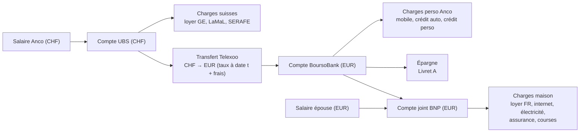
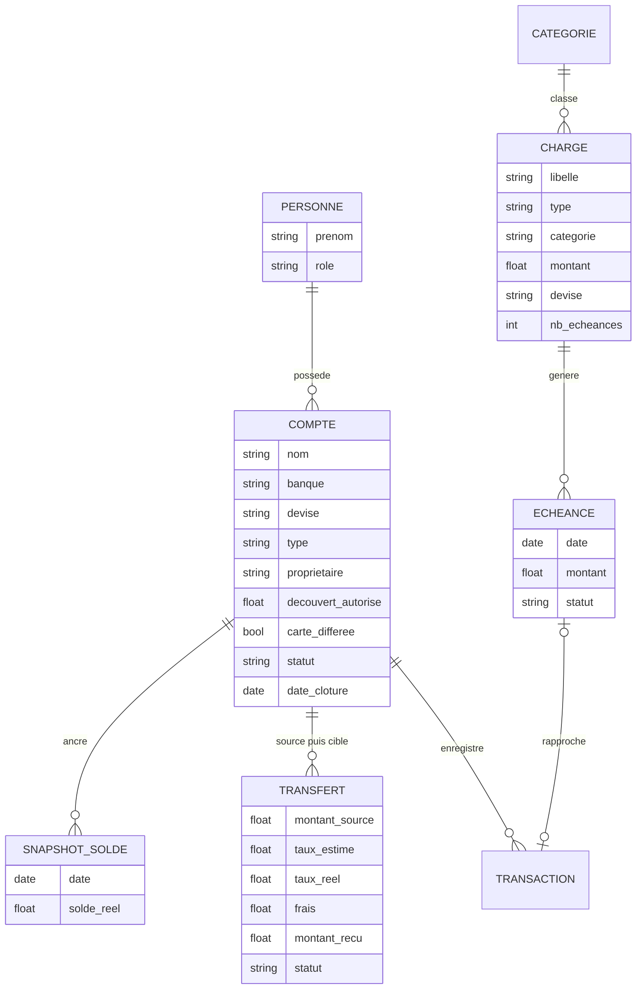

# Cahier des charges — Mbongo

**Nom de code :** Mbongo (« argent » en lingala) — nom de code provisoire, définitif à votre main.
**Statut :** v0.9 — BFF Next.js + Prisma ; MVC transposé en POO (controllers + services en classes)
**Date :** 29/10/2026
**Philosophie du projet :** parcimonie. Pas de fonctionnalité sans besoin réel. V1 minimale mais solide, façonnable ensuite.

---

## 1. Contexte et objectifs

**Pourquoi cette app :** aucune app budgétaire grand public ne couvre correctement la situation mixte France/Suisse (multi-devises, charges CH spécifiques comme la LaMaL et la SERAFE, impôts dans 2 pays, transferts CHF→EUR avec frais). Plutôt que plier un outil existant à vos règles, construire l'outil autour de vos règles.

**Objectifs de la V1 :**

1. Centraliser les soldes de tous les comptes (CH + FR) avec une vue globale consolidée, ancrée sur des relevés réels.
2. Gérer toutes les typologies de charges, y compris les échelonnées (4x carte, impôt en 4 prélèvements, crédits) et les paiements à venir obligatoires (SERAFE).
3. Visualiser où va l'argent : **diagramme de Sankey des flux** (revenus → comptes → charges/épargne).
4. Modéliser le flux d'argent réel du couple (salaire CHF → charges CH → transfert → EUR → perso/joint), avec les réalités bancaires (découvert, carte à débit différé).

**Non-objectifs de la V1 (explicitement exclus) :**

- Agrégation bancaire automatique (open banking) — saisie manuelle + import CSV de relevés téléchargés soi-même.
- Conseils LLM — prévu en v1.x.
- Suivi des investissements (PEA, CTO) — prévu en v2.
- Patrimoine immobilier / hypothèque — prévu en v3.
- Conseil fiscal : l'app modélise vos impôts, elle ne conseille pas.

---

## 2. Situation du foyer (périmètre réel)

| Personne | Situation actuelle | Évolution prévue |
| --- | --- | --- |
| Anco | Vit et travaille à Genève, salaire en CHF (ancien frontalier) | — |
| Épouse | Vit et travaille en France, salaire en EUR (< 10 000 €/an) | Rejoindra Genève + travail GE dans quelques mois |

⚠️ **Implication forte :** l'app doit absorber le futur changement de situation (2 ème salaire en CHF, nouvelles charges CH pour elle, résiliation de charges FR) **sans refonte du modèle**. D'où : comptes et charges typés par pays/devise/propriétaire, pas de structure figée sur la situation actuelle.

### 2.1 Comptes existants et à venir

| Compte | Banque | Devise | Rôle | Spécificités |
| --- | --- | --- | --- | --- |
| Courant CH | UBS (à ouvrir) | CHF | Réception salaire, charges suisses | Carte débit ; **pas de découvert** (usage suisse : la carte de crédit tient ce rôle) |
| Carte de crédit UBS | UBS (à ouvrir) | CHF | Dépenses carte — fidélité KeyPoints (miles, contexte d'usage uniquement, hors périmètre) | **Compte carte distinct**, facture mensuelle prélevée sur le courant ; l'encours se suit comme un solde |
| Courant EUR perso | BoursoBank | EUR | Charges perso, épargne | Découvert autorisé possible |
| Joint EUR | BNP | EUR | Charges de la maison | **Carte à débit différé** (débit des paiements en fin de mois) ; CSV téléchargeable uniquement depuis la plateforme web BNP |
| Livret A | — | EUR | Épargne réglementée | Plafond 22 950 €/personne |
| Épargne CH | à définir | CHF | Épargne côté suisse | à définir |

### 2.2 Flux d'argent actuel



### 2.3 Spécificités bancaires à modéliser

1. **Découvert** : un compte peut être négatif. Le solde réel peut diverger du solde théorique issu des saisies — d'où le rapprochement (§ 3.5).
2. **Carte à débit différé (BNP)** : les paiements carte du mois M ne sont débités du compte qu'en fin de mois M, en une fois. Spécificité de budget : la dépense compte dans le mois M (catégorie), le flux de trésorerie dans M (fin de mois). L'app doit afficher l'« encours carte » en cours de mois et générer l'échéance de prélèvement de fin de mois.
3. **Relevés CSV** : téléchargeables uniquement depuis les plateformes web des banques (contrainte BNP confirmée). L'import sera donc un flux manuel : vous téléchargez, vous importez le fichier dans Mbongo.
4. **Cartes suisses** : pas de découvert sur le courant CH — l'usage suisse est **carte débit** (prélèvement immédiat) + **carte de crédit** (compte carte distinct, facture mensuelle prélevée sur le courant). La carte UBS servira aussi au programme de fidélité (KeyPoints convertibles en miles) — contexte d'usage, hors périmètre v1. Le mécanisme « encours carte + échéance de facturation » est **le même** que pour la carte BNP à débit différé : une seule implémentation, deux habillages.
5. **Résiliation de compte** : un compte doit pouvoir être clos (ex. résiliation du compte BNP) sans perdre l'historique — voir cycle de vie § 3.6.

---

## 3. Concepts métier (modèle de données)

### 3.1 Entités clés



Définitions :

- **Personne** : membre du foyer, informations strictement nécessaires (prénom, rôle). Mono-utilisateur : une seule session, mais le foyer peut compter plusieurs personnes.
- **Compte** : compte bancaire ou d'épargne — devise, type, propriétaire (personne ou couple), **découvert autorisé**, **carte à débit différé** (oui/non).
- **Charge** : un engagement de paiement, qui génère une ou plusieurs **échéances**. Vocabulaire retenu partout (UI et code) : « charge », pas « engagement ».
- **Échéance** : un montant à une date. Statuts : `à venir` → `dû` → `payé` (rapproché d'une transaction).
- **Transaction** : mouvement réel constaté sur un compte.
- **Transfert** : mouvement inter-comptes, avec conversion CHF↔EUR (règle § 3.3).
- **Snapshot de solde** : solde réel déclaré à une date t — l'ancre du rapprochement (§ 3.5).

### 3.2 Typologie des charges — le cœur de l'app

C'est le besoin mal couvert par les apps existantes. Cinq types :

| Type | Définition | Exemples concrets | Comportement attendu |
| --- | --- | --- | --- |
| **Fixe récurrente** | Montant connu, récurrence régulière, montant révisable | Loyer, LaMaL (révisée chaque 1er janvier), forfait mobile, internet | Se génère seule ; alerte si le montant réellement payé diffère |
| **Échelonnée** | Engagement unique décomposé en N échéances connues | Crédit auto (48 mois), impôt FR (4 prélèvements), paiement 4x carte | Affiche l'échéancier complet + le **capital/total restant dû** |
| **Temporaire** | Récurrence avec date de fin connue | Abonnement résiliable, engagement 12 mois | Se génère jusqu'à la date de fin, puis s'arrête |
| **Ponctuelle** | Une seule fois, payée ou à payer | Fracture dentaire, achat exceptionnel | N'apparaît qu'au mois concerné |
| **À venir / engagée** | Obligation non encore prélevée, date et montant connus ou estimés | Facture SERAFE annuelle, régularisation d'impôt, remboursement DRIS attendu | Visible dans l'échéancier dès la saisie, impacte la trésorerie prévisionnelle |

**+ Mécanisme de provision** (transversal) : pour toute charge annuelle ou échelonnée, option « lisser sur 12 mois » → l'app affiche un coût mensuel provisionné (ex. SERAFE ≈ 28 CHF/mois) et suit ce qui a été mis de côté, sans l'obliger à déplacer réellement l'argent.

**Règle clé :** le budget d'un mois = échéances du mois + provisions du mois. Les charges à venir plombent la trésorerie prévisionnelle même si elles ne sont pas encore prélevées.

### 3.3 Transferts CHF→EUR en 2 phases (règle métier spécifique)

Le transfert Telexoo/Wise a un taux et des frais réels inconnus au moment de l'envoi. Modélisation :

- **Phase 1 — « Estimé »** : vous saisissez le montant CHF envoyé. L'app applique un taux de référence (dernier taux saisi ou taux saisi à la main) et affiche la contre-valeur EUR **avec la mention « taux au JJ/MM/AAAA »**. Tous les calculs aval utilisent ce taux, réputé vrai.
- **Phase 2 — « Réalisé »** : dès réception, vous saisissez le **montant EUR réellement crédité**. L'app en déduit le **taux effectif réel** et les **frais totaux** (Telexoo/Wise), puis **recalcule automatiquement** tout ce qui reposait sur le taux estimé.

Principes :

- Aucun taux implicite : chaque montant converti est stocké avec son taux et sa date.
- Les frais sont saisis ou déduits, jamais fondus dans le taux (traçabilité).
- L'historique des taux utilisés est conservé (utile pour le conseiller LLM en v1.x).

### 3.4 Multi-devises

- Devises natives : **CHF** et **EUR**. Devise de consolidation : **EUR** (choix du couple, réflexion en euros) — affichage parallèle des totaux CHF natifs.
- Vue globale = somme par devise + total consolidé au taux courant, **toujours affiché avec sa date** (« au taux du 29/10/2026 »).
- V1 : taux saisi manuellement (valeur + date). V1.x : récupération du taux du jour via API, affiché « taux à date t » (jamais présenté comme temps réel).

### 3.5 Solde, relevés CSV et rapprochement

**Le principe : le solde réel à une date t est l'ancre ; les transactions expliquent le mouvement.**

Deux chemins complémentaires — les deux valables en v1, utilisables indépendamment :

1. **Snapshot manuel (le socle)** : « le solde de ce compte est X au JJ/MM ». Si l'écart avec le solde calculé à partir des transactions existe, l'app propose une **transaction d'ajustement** (que vous validez ou investiguez). C'est le rapprochement à la main — suffisant pour un POC, et le seul nécessaire pour « se rendre compte » visuellement.
2. **Import du relevé CSV (le confort)** : vous téléchargez le relevé depuis la plateforme web de la banque (contrainte BNP : web uniquement), vous importez le fichier. L'app ajoute les transactions manquantes, dédoublonne (sur date + montant + libellé), et propose de ré-ancrer le solde sur la dernière ligne du relevé. Ré-importable à tout moment.

**Décision de conception :** le CSV n'est pas requis pour la justesse du solde. Le snapshot suffit ; le CSV remplit l'historique des transactions et fiabilise les catégories. On peut donc actualiser un solde en 10 secondes, et compléter les détails plus tard.

**Découvert :** le solde peut être négatif sur les comptes qui l'autorisent (FR) ; en Suisse, pas de découvert — la carte de crédit joue ce rôle. L'alerte de trésorerie prévisionnelle intègre le découvert autorisé du compte (approche de la limite → alerte ; dépassement → alerte forte).

### 3.6 Cycle de vie d'un compte (clôture sans perte d'historique)

Résilier un compte (ex. la BNP un jour) est un cas normal, pas une erreur à effacer :

- Un compte a un **statut** : `actif` → `clos`, avec **date de clôture**.
- À la clôture : solde final attendu (0 en pratique), les récurrences des charges liées s'arrêtent à la date de clôture, le compte disparaît des vues courantes (dashboard, échéancier) — mais **l'historique est conservé** : les statistiques passées restent justes, le Sankey d'une année écoulée montre toujours le compte tel qu'il était.
- **Jamais de suppression physique** (soft delete) : les transactions et échéances passées référencent le compte ; l'intégrité des données prime. (Un compte vierge et créé par erreur, en revanche, peut être supprimé réellement.)

---

## 4. Exigences fonctionnelles V1 (priorisation MoSCoW)

### Must have

| # | Exigence | Détail / critère d'acceptation |
| --- | --- | --- |
| F1 | Gestion des comptes | CRUD compte : nom, banque, devise (CHF/EUR), type (courant/épargne/**carte de crédit**), propriétaire (personne/couple), découvert autorisé (0 par défaut — pas de découvert en Suisse), carte à débit différé (oui/non), **statut actif/clos + date de clôture** (§ 3.6). Soldes calculés à partir des transactions + snapshots. |
| F2 | Transactions manuelles | Saisie date, montant, sens, compte, catégorie, note. Solde par compte fiable à tout moment. |
| F3 | Charges typées | Les 5 types du § 3.2, avec génération automatique des échéances (récurrence, dates de fin, N échéances). |
| F4 | Échéancier | Vue des échéances à venir (liste + 60 prochains jours), statut à venir/dû/payé, rapprochement manuel avec une transaction. |
| F5 | Transfert 2 phases | Règle du § 3.3 : estimé → réalisé, taux effectif + frais déduits, recalcul automatique. |
| F6 | Dashboard | Soldes par compte (découvert visible), totaux par devise, total consolidé EUR au taux daté. Sankey des flux du mois (revenus → comptes → charges/épargne). |
| F7 | Solde & rapprochement | Snapshot manuel du solde à date t + transaction d'ajustement (§ 3.5). Encours carte affiché (débit différé FR et carte de crédit CH — même mécanisme) + échéance de facturation/prélèvement générée automatiquement. |
| F8 | Vue foyer | Comptes et charges filtrables par personne / couple ; membres du foyer paramétrables (info strictement nécessaire). |

### Should have

| # | Exigence | Détail |
| --- | --- | --- |
| F9 | Import CSV relevés | Parse des CSV UBS / BNP / BoursoBank, dédoublonnage, proposition d'ancrage du solde sur le relevé (§ 3.5). Formats à collecter au moment du dev. |
| F10 | Provisions | Lissage mensuel des charges annuelles/échelonnées, suivi de la provision SERAFE, impôts, etc. |
| F11 | Alertes basiques | Échéance dans les 7 jours ; trésorerie prévisionnelle négative ; approche du découvert autorisé. |
| F12 | Épargne | Suivi du Livret A : solde, plafond (22 950 €/personne), place restante. |
| F13 | Capital restant dû | Pour les crédits échelonnés : échéancier complet, **capital restant dû** et mensualités affichées. |

### Could have (si le temps le permet)

| # | Exigence |
| --- | --- |
| F14 | Donut des dépenses par catégorie (vue complémentaire du Sankey) |
| F15 | Barres budget vs réalisé par catégorie (nécessite budgets cibles par catégorie — sinon v1.1) |
| F16 | Export des données (JSON/CSV) — en plus de la sauvegarde locale |

### Won't have en V1 (reportés, pas abandonnés)

- Agrégation open banking, conseils LLM (v1.x), PEA/CTO (v2), patrimoine (v3), notifications push, multi-langue, multi-comptes utilisateurs avec auth séparée.

---

## 5. Règles métier CH/FR intégrées d'office

Règles vérifiées le 29/10/2026 (sources en § 11) — intégrées comme configurations par défaut, modifiables :

| Charge | Règle réelle | Modélisation dans l'app |
| --- | --- | --- |
| **SERAFE** (redevance radio-TV) | 335 CHF/an et par ménage en 2026, 312 CHF dès 2027. Facture annuelle, échéancier étalé sur 12 groupes (le mois d'arrivée varie par ménage), payable sous 60 jours. Option : facturation trimestrielle (83,75 CHF, e-facture). | Charge « à venir » annuelle + **provision ≈ 28 CHF/mois**. Ce n'est pas une date fixe universelle — l'app permet de saisir le mois de facturation réel de votre ménage. |
| **LaMaL** (Genève) | Prime mensuelle par personne, révisée chaque année (annonce OFSP fin septembre, en vigueur au 1er janvier). Genève 2027 : prime moyenne 508,60 CHF/mois. | Charge fixe récurrente avec **montant révisable annuellement** + rappel de révision chaque automne. À l'arrivée de l'épouse : 2ème prime LaMaL à prévoir. |
| **Impôt sur le revenu FR** | Solde > 300 € prélevé en **4 échéances** (25/09, 26/10, 25/11, 28/12) ou mensualisation possible. | Charge **échelonnée** type « 4 échéances » ; le type de charge la couvre nativement. |
| **Impôt GE — à la source** | Anco : imposé à la source, barème C0Y (couple, deux revenus, pas d'enfant). Le barème C **impute un revenu théorique ≈ 70 500 CHF au conjoint** qui travaille. Le revenu réel de l'épouse étant bien inférieur, une **DRIS** (rectification, dépôt au plus tard le 31 mars de l'année suivante) peut corriger le forfait et réduire le précompte. La **TOU** (taxation ordinaire ultérieure) est une autre voie : obligatoire dès 120 000 CHF de brut, si conjoint sans activité, immobilier ou indépendant ; sinon sur demande. | Charge fixe récurrente mensuelle (montant du barème, révisable chaque janvier) + **procédure annuelle DRIS/TOU modélisée comme charge « à venir »** (rappel avant le 31 mars) avec remboursement attendu saisissable. Le choix DRIS vs TOU relève de vous, pas de l'app. |
| **Livret A** | Plafond 22 950 € par personne, taux révisé au 1er février et au 1er août, intérêts calculés par quinzaines. | V1 : solde + plafond + place restante. V1.x : calcul des intérêts par quinzaines. |
| **Crédits auto/perso** | Mensualités fixes sur N mois. | Charge échelonnée + capital restant dû. |
| **Découvert / carte différée** | Réalité des comptes FR/CH : découvert autorisé variable selon compte ; carte BNP à débit différé (fin de mois). | Attributs de compte + alertes trésorerie + encours carte + échéance de prélèvement auto (§ 3.5). |

---

## 6. Visualisations V1

1. **Dashboard global** : soldes par compte (découvert visible), totaux CHF / EUR / consolidé EUR (taux daté).
2. **Sankey des flux** — la visualisation phare : revenus → comptes → catégories de charges / épargne, sur le mois ou une période au choix. C'est le graphique « où va l'argent ».
3. **Échéancier** : liste/calendrier des paiements à venir (60 jours), avec le provisionnel mensuel en colonne.
4. **Donut des dépenses** par catégorie (could have) — complément du Sankey, pas son remplaçant.

Principe : chaque chiffre converti affiche sa devise d'origine ET sa contre-valeur au taux daté.

---

## 7. Évolutions planifiées (hors V1, pour mémoire)

### V1.x — Assistant LLM (conseil, jamais décision)

- **Warnings** : « la SERAFE arrive dans 3 semaines », « ce paiement arrive — trésorerie insuffisante si vous dépensez X », « vous approchez du découvert autorisé ».
- **Projections** : « mettre 200 €/mois en ETF → ≈ X dans 10 ans ». Projection paramétrable (rendement, horizon).
- **Conseils données-driven** : « votre revenu a augmenté de X % → augmenter le versement de Y, nouvelle projection ».
- Garde-fous : le LLM **lit** les données, ne les modifie jamais ; chaque conseil cite la donnée qui le fonde ; pas de recommandation produit ni de conseil fiscal.

### V2 — Investissements (PEA, CTO)

- Vision : le budget alimente l'investissement. Les PEA/CTO sont des **comptes de patrimoine** ; le flux « épargne investie » est déjà une charge en v1, ce qui rendra les projections LLM justes dès la v1.x.
- Positionnement légitime : le budget inclut la capacité d'épargne, l'investissement est sa destination. Détail à figer dans un cahier des charges v2 dédié, **quand le besoin sera réel**.

### V3 — Patrimoine

- Hypothèque, patrimoine immobilier et mobilier. Vraiment plus tard.

---

## 8. Contraintes et choix techniques

| Sujet | Décision |
| --- | --- |
| Plateforme | **Web-first, PWA responsive** (usage majoritairement mobile, développement web = votre terrain). Installation iPhone : Safari → Partager → « Sur l'écran d'accueil » (aucun App Store requis, fonctionnement plein écran, offline via service worker, notifications push possibles sur iOS ≥ 16.4 pour une PWA installée). Wrapper natif (Capacitor) plus tard seulement si besoin réel (App Store, verrouillage biométrique natif). |
| Stack | **Next.js fullstack (BFF) + Prisma + zod + SQLite** — un seul déployable, un seul service. Le MVC NestJS est **transposé à l'intérieur du BFF** : route handlers minces = controllers, `server/` = classes de service + client Prisma, `packages/shared` = zod + domaine pur (§ 8.2). Monorepo pnpm : `apps/web` + `packages/shared` ; déploiement = un `docker compose` (1 service, SQLite sur volume). |
| Développement | **Mixte** : Vibe structure et génère, vous raffinez. Code simple, lisible, testé ; pas de dépendance superflue (parcimonie). |
| Données | Saisie **manuelle + snapshots de solde** en v1 ; import CSV des relevés en should have. Données bancaires sensibles → voir hébergement. |
| Utilisateurs | **Mono-utilisateur** (une session, pas de gestion d'auth multi-rôles) + entité « membres du foyer » avec informations strictement nécessaires. Chacun saisit à son tour sur la même session. |
| Multi-devises | CHF + EUR natifs, consolidation EUR, taux toujours daté, transfert 2 phases (§ 3.3). |

### 8.1 Hébergement (comparé et tranché)

Menace réelle : données bancaires centralisées = cible. Réponse de parcimonie : **minimiser la surface d'attaque plutôt que empiler les défenses** — tout en tenant compte de votre temps disponible.

| Option | Coût | Matériel | Temps de maintenance | Surface d'attaque |
| --- | --- | --- | --- | --- |
| **A. VPS privé + Tailscale (recommandé)** | ≈ 4–5 €/mois | aucun | ~2 h à l'installation, quasi nul ensuite (mises à jour automatiques) | **Nulle** : aucun port ouvert, aucune URL publique |
| B. Maison (Pi / vieux PC + Tailscale) | matériel ~0–90 €, 0 €/mois | à acheter ou récupérer | plus élevée : hardware, coupures, sauvegardes à surveiller | Nulle aussi, mais disponibilité = celle de votre maison |
| C. VPS avec HTTPS public | ≈ 4–5 €/mois | aucun | idem A + vigilance sécurité | Faible mais réelle : URL publique à durcir (auth forte, rate-limit) |

**Décision v0.3 : option A.** Un petit VPS (type Hetzner CX22) + Docker (`compose` : un seul service, SQLite sur volume) + **Tailscale** : la machine est sur Internet mais l'app n'est **pas exposée** — accessible uniquement depuis les appareils du couple (Tailscale, gratuit, installable sur les deux iPhones). Backups chiffrés automatiques vers un second support. L'option B (maison) reste ouverte le jour vous avez du matériel et l'envie ; l'option C seulement si un accès sans VPN devient un vrai besoin.

### 8.2 Architecture du code — BFF Next.js, MVC transposé

Un seul déployable : **l'app Next.js est le backend** (pattern BFF). Pas de NestJS à côté, pas d'archi hexagonale, pas de couche « commands » : on **transpose dans le BFF le MVC que vous maîtrisez** — controllers = route handlers minces, services = classes (une par domaine), accès données = Prisma (client généré). Le fil anti-chaos, confirmé par les retours d'expérience sur les BFF Next.js : **handlers de transport pur, couche service obligatoire, `app/` ne fait que du routage** — la logique qui s'accumule dans les handlers est la recette du spaghetti.

```
apps/web/
├── prisma/schema.prisma              # modèle de données → entités générées (client + types)
└── src/
    ├── app/                          # routage uniquement
    │   ├── (dashboard)/charges/page.tsx  # page RSC → appelle le service en direct
    │   ├── api/charges/route.ts          # wiring pur : exporte les méthodes du ChargesController
    │   └── loading.tsx / error.tsx       # plumbing Next : attente, erreur
    ├── server/                       # le backend transposé — jamais importé par le client
    │   ├── charges/
    │   │   ├── charges.controller.ts # classe ChargesController : valider → service → répondre
    │   │   └── charge.service.ts     # classe ChargeService : findMany, findOne, create, update, remove
    │   ├── accounts/  transfers/ …   # même découpage par domaine
    │   ├── common/                   # filterToWhere, parseurs zod, mapping d'erreurs
    │   └── db.ts                     # PrismaService maison : singleton du client généré
    ├── components/                   # UI par feature, guards de domaine inclus
    ├── hooks/                        # hooks de domaine (client, TanStack Query)
    └── lib/                          # client typé vers /api (fetch + zod)
packages/shared/
├── schemas/                          # zod : modèle, create, update, query (source unique)
├── domain/                           # règles métier pures (échéances, conversion)
└── lib/calculation/                  # provisions, restant dû, agrégation Sankey
```

**Règles inviolables (le « cadre » anti-chaos, écrit dans le repo) :**

- **R1** — le transport vit dans des **classes Controller** (`server/charges/charges.controller.ts`) : valider (zod) → appeler le service → répondre. Les fichiers `route.ts` sont du **wiring pur** (trois lignes : ils exportent les méthodes du controller — le rôle de `main.ts` chez Nest). Zéro logique hors du controller. (Le piège n° 1 du BFF : l'orchestration dans les handlers.)
- **R2** — `packages/shared` (domain + calculs) = fonctions pures (ni React, ni MikroORM), **exécutables côté front ou back**, testées sans monter de serveur. Les règles du cahier des charges (§ 3) vivent là.
- **R3** — **Prisma** : le client **généré est la couche entité et la seule couche qui parle à la base** (aucune classe entité manuscrite — `schema.prisma` est la définition, standard des stacks NestJS + Prisma ; les services ne contournent jamais le client). Filtre en deux temps, chacun à sa place : le controller **valide** la query (zod, `chargeQuerySchema`), le service **traduit** en `where` Prisma via le helper unique `filterToWhere` (`server/common/`). La traduction reste dans le service car il a **deux appelants** — les controllers ET les pages RSC (R5) — une traduction unique, pas deux. Un besoin de lecture se **paramètre**, il ne se code pas. (Libs de filtres examinées et **écartées** : `@chax-at/prisma-filter`, `api-query-params`, `prisma-searchparams-mapper` — soit elles imposent leurs conventions à une stack plus grosse, soit elles sont trop jeunes pour qu'un projet perso en dépende ; le helper maison fait ~20 lignes, écrit une fois.)
- **R4** — **services = classes** (une par domaine, exportées en singleton : `chargeService`, `accountService`…) : CRUD + méthodes transactionnelles quand le CRUD seul ne garantit pas l'invariant (~10 % : création de charge avec échéances, phase 2 du transfert, clôture de compte, ancrage de snapshot, import CSV). **Pas de couche « command » séparée** : une méthode transactionnelle suffit. **Nomenclature NestJS** : `findMany`, `findOne`, `create`, `update`, `remove` — jamais `findCharges` dans `charge.service.ts` (le contexte est déjà porté par la classe).
- **R5** — **les pages RSC appellent les services directement** (appel de fonction, jamais de `fetch` vers sa propre API). `/api/**` n'existe que pour le navigateur (mutations et lectures hydratées). Les dépendances vont dans un seul sens : `app → server → shared` ; aucun composant client n'importe `server/` (garanti par `import "server-only"` dans `db.ts`).
- **R6** — les conventions sont écrites dans un `CONVENTIONS.md` à la racine, référencé dans chaque session de génération (le garde-fou « avec l'IA, on vite fait de faire n'importe quoi »).
- **R7** — les types se déclarent **une seule fois** : schémas **zod** dans `packages/shared`, consommés par les route handlers (validation), les services et le web (formulaires RHF). **Jeu complet par modèle, toujours le même** : `chargeSchema` (persisté), `createChargeSchema` (`chargeSchema.omit({ id })`), `updateChargeSchema` (`createChargeSchema.partial()` — **partial zod, jamais `Partial<>` TS**), `chargeQuerySchema` (filtres typés). Monorepo pnpm (`apps/web` + `packages/shared`).
- **R8** — **server-first, sans état client** : guards de domaine (RSC + `<Suspense>` pour l'attente + `error.tsx` pour l'échec) ; TanStack Query = cache de lecture hydraté, exposé par des hooks de domaine (`useCharges`, `useAccounts`…) → aucun props drilling ; mutations client via `useMutation` → `/api` + invalidation. Pas de store, pas de Context, pas de server actions.
- **R9** — les calculs vivent en **lib partagée** et s'exécutent là où la donnée se trouve déjà (souvent le front : le Sankey du mois s'agrège côté client à partir des transactions déjà chargées — aucune route « getSankey »).
- **R10** — **le code est en anglais** (identifiants, commentaires, commits). L'UI et ce cahier des charges restent en français.

**Principes de code (philosophie du projet) :**

- **Tout déléguer** : tout ce qui est délégable va à une lib éprouvée — formulaires → React Hook Form, UI → shadcn/ui, charts → Recharts, validation → zod, ORM → MikroORM, dates → **date-fns** (jamais de manipulation `Date` maison), style → Tailwind. On ne réinvente pas la roue ; le code maison ne contient que le métier.
- **Le domaine reste fonctionnel** : calculs et règles = fonctions pures en lib partagée ; les classes se limitent au câblage (services, par confort NestJS) — pas de classes métier riches, pas d'état caché.
- **Composition partout** : les pages se ressemblent (layout, toolbar, vues) ; ce qui diffère, c'est ce qu'on leur donne — un formulaire ici, une table et un chart là. Composants composables façon compound components (`<DataTable><DataTable.Header>…`), slots shadcn.
- **Les layers Next font le plumbing** : `loading.tsx`, `error.tsx`, `<Suspense>` — l'attente et l'erreur sont déclaratives, pas codées à la main dans chaque page.
- **Flux de données à sens unique** : le serveur est la source, le client une vue. Les conteneurs de domaine (« guards ») chargent et garantissent la donnée ; les composants d'affichage sont sans effet de bord — ils reçoivent (props d'un niveau ou hooks de domaine) et rendent, c'est tout.

Résultat : un seul serveur à déployer, et la structure que vous maîtrisez de bout en bout — les handlers se lisent en dix lignes, la logique vit dans les services, on sait où est quoi sans deviner. Et si un vrai client mobile surgit un jour, `/api` existe déjà, propre et typé.

---

## 9. Décisions tranchées (29/10/2026) et questions restantes

| # | Sujet | Décision v0.2 |
| --- | --- | --- |
| 1 | Nom | **Mbongo** (nom de code ; « argent » en lingala) — définitif ou pas, à voir |
| 2 | Devise de consolidation | **EUR** (réflexion du couple en euros) ; totaux CHF affichés en parallèle |
| 3 | Stack | **Next.js fullstack (BFF) + Prisma + zod + SQLite** (v0.8) — un seul déployable (argument infra décisif) ; MVC transposé dans le BFF ; **Prisma confirmé** (maîtrisé aussi, singleton officiel avec Next.js, `$transaction` couvre les 5 opérations transactionnelles) |
| 4 | Utilisateurs | **Mono-utilisateur + membres du foyer** (info strictement nécessaire, saisie à tour de rôle) |
| 5 | Impôt GE | **À la source, barème C0Y** ; DRIS probable (revenu réel épouse < forfait barème C ≈ 70 500 CHF) ; TOU à envisager. Modélisé § 5 |
| 6 | Hébergement | **VPS privé (~5 €/mois) + Tailscale** : zéro port ouvert, zéro matériel à acheter, maintenance ≈ nulle après installation ; backups chiffrés automatiques. Maison et HTTPS public documentés en repli (§ 8.1) |
| 7 | Crédits | **Oui** : capital restant dû + mensualités affichées |
| 8 | Mobile | **PWA installée** (Safari → « Sur l'écran d'accueil ») — pas d'App Store, pas de compte développeur, pas de frais |
| 9 | Vocabulaire | « **Charge** » partout (UI et code) — « engagement » abandonné |
| 10 | Comptes suisses | Carte débit + carte de crédit (compte carte distinct, facturation mensuelle) ; **pas de découvert** sur le courant CH ; fidélité KeyPoints = contexte, hors périmètre |
| 11 | Clôture de compte | **Soft delete** : statut clos + date, historique conservé, récurrences arrêtées (§ 3.6) |
| 12 | Types partagés | Monorepo pnpm, **zod = source unique des types** partagés front/back |
| 13 | Data flow client | **Server-first** : pas de store, pas de Context ; guards de domaine (RSC + Suspense + error.tsx) ; TanStack Query en cache de lecture hydraté, exposé par hooks de domaine → zéro props drilling ; mutations client via `useMutation` → `/api` + invalidation |
| 14 | Backend | **BFF Next.js, MVC transposé en POO** : controllers et services = classes, `route.ts` = wiring pur, entités générées par Prisma — pas d'archi hexagonale, pas de couche commands ; CRUD filtré + méthodes transactionnelles ; calculs en lib partagée (souvent front) ; date-fns |
| 15 | Langue du code | **Anglais** : identifiants, commentaires, commits. UI et cdc en français |
| 16 | Filtres de lecture | zod (filtres typés, validés dans le handler) + helper unique `filterToWhere` dans `server/common/` ; libs examinées (`@chax-at/prisma-filter`, `api-query-params`, `prisma-searchparams-mapper`) et écartées : conventions imposées ou projet trop jeune |

**Questions restantes (mineures, à trancher en cours de dev) :** formats CSV exacts des 3 banques (à collecter lors du dev de F9) ; nom définitif.

---

## 10. Jalons proposés

| Jalon | Contenu | Critère de sortie |
| --- | --- | --- |
| **M0 — Spec figée** | Ce document passe en v1.0 | Décisions § 9 confirmées (fait) |
| **M1 — POC** | F1 comptes, F2 transactions, F5 transfert 2 phases, F7 snapshots | Le flux salaire → Telexoo → BoursoBank → joint est saisissable de bout en bout, soldes justes |
| **M2 — Cœur métier** | F3 charges typées, F4 échéancier, F7 carte différée | Une charge échelonnée (impôt 4x) et la SERAFE modélisées correctement |
| **M3 — V1 utilisable** | F6 dashboard + **Sankey**, F8 vue foyer, F9 import CSV, F10 provisions, F11 alertes, F13 capital restant | Utilisation réelle en remplacement de tout suivi existant |
| **M4 — V1.x** | API taux du jour, puis assistant LLM | Un warning pertinent émis sur de vraies données |

---

## 11. Sources (règles vérifiées le 29/10/2026)

- SERAFE — facturation et échéanciers : [serafe.ch/fr/redevance/facturation](https://www.serafe.ch/fr/redevance/facturation/)
- Redevance SERAFE 2026/2027 (335 → 312 CHF) : [rappn.ch/fr/redevance-serafe](https://rappn.ch/fr/redevance-serafe)
- Impôts FR — 4 prélèvements du solde : [service-public.gouv.fr](https://www.service-public.gouv.fr/particuliers/vosdroits/F33890)
- Primes LaMaL Genève 2027 (OFSP) : [smart-leman.ch](https://smart-leman.ch/primes-lamal-2027-geneve/)
- TOU Genève — conditions d'obligation et de demande : [ge.ch](https://www.ge.ch/demande-rectification-taxation-ordinaire-ulterieure/quand-demander-annoncer-taxation-ordinaire-ulterieure)
- DRIS/TOU — barèmes, forfait conjoint barème C (~70 500 CHF), délai du 31 mars : [ibani.com](https://www.ibani.com/guides/rectification-impot-source-geneve-dris-frontalier)