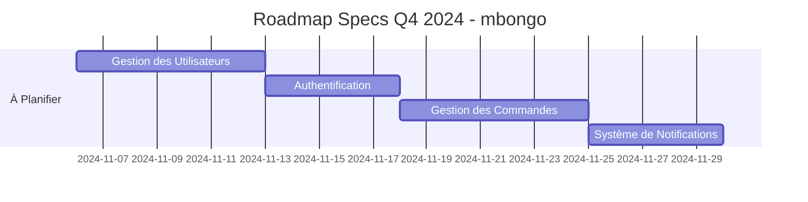

# INDEX.md - Index des Spécifications

> **Index central de toutes les specs du projet mbongo.**
> *Mettre à jour cet index à chaque nouvelle spec ou modification.*

---

## 📊 Statistiques

```
Total Specs: 2
├── Validées: 0
├── En Review: 2
├── En Brouillon: 0
└── Obsolètes: 0

Temps moyen par spec: N/A
Specs en retard: 0
```

---

## 🎯 Specs Validées (✅)

*Aucune spec validée pour le moment.*

### Légende Statut Dev
- ✅ **Complété**: Développement terminé et déployé
- 🔄 **En cours**: Développement en cours
- ⏳ **À commencer**: Spec validée, dev pas encore commencé
- ❌ **Bloqué**: Développement bloqué (voir notes)

---

## 🔍 Specs En Review (🔍)

| ID | Feature | Statut | Priorité | Spec |
|----|---------|--------|----------|------|
| M1-POC-001 | Socle : comptes, transactions, transferts, snapshots | 🔍 En review | HIGH | [SPEC-M1-POC](m1-poc/SPEC.md) |
| TOOLING-001 | Runner npm et Turbo du monorepo | 🔍 En review | HIGH | [SPEC-TOOLING-001](tooling-foundation/SPEC.md) |

---

## ✏️ Specs en Brouillon (📝)

*Aucune spec en brouillon pour le moment.*

---

## 🗑️ Specs Obsolètes (🗑️)

*Aucune spec obsolète pour le moment.*

---

## 📈 Roadmap des Specs

### Q4 2024



### Prochaines Specs Prioritaires

| Priorité | ID | Titre | Date Cible | Dépendances |
|----------|----|-------|------------|--------------|
| 🔴 HIGH | USER-MGT-001 | Gestion des Utilisateurs | 2024-11-07 | Aucune |
| 🔴 HIGH | AUTH-001 | Authentification JWT | 2024-11-09 | USER-MGT-001 |
| 🔴 HIGH | ORDER-MGT-001 | Gestion des Commandes | 2024-11-12 | AUTH-001 |
| 🟡 MEDIUM | NOTIF-001 | Système de Notifications | 2024-11-15 | USER-MGT-001 |

---

## 🔍 Recherche Rapide

### Par Domaine

*Pour le moment, aucun domaine défini.*

### Par Statut

- **🟢 À développer**: (aucun)
- **🟡 En review**: (aucun)
- **🔴 En retard**: (aucun)

### Par Priorité

- **🔴 HIGH**: (aucun)
- **🟡 MEDIUM**: (aucun)
- **🟢 LOW**: (aucun)

---

## 📁 Structure des Fichiers

```
docs/
└── specs/
    ├── INDEX.md                     # Ce fichier
    └── <nom-de-la-feature>/        # À créer pour chaque feature
        ├── SPEC.md                  # Spécification principale
        ├── diagrams/
        │   ├── architecture.mmd     # Diagramme d'architecture
        │   └── sequence.mmd          # Diagrammes de séquence
        ├── examples/
        │   ├── request.json          # Exemple de requête
        │   └── response.json         # Exemple de réponse
        └── decisions.md             # Décisions techniques
```

---

## 🛠️ Comment Utiliser Cet Index

1. **Trouver une spec**: Utiliser la recherche ou parcourir par domaine
2. **Créer une spec**: 
   - Copier `skills/spec-driven-development/SPEC_TEMPLATE.md` dans `docs/specs/<nom>/SPEC.md`
   - Remplir tous les champs obligatoires
   - Ajouter une entrée dans cet index
3. **Mettre à jour**: 
   - Mettre à jour le statut quand la spec évolue
   - Garder les statistiques à jour
4. **Archiver**: 
   - Déplacer les specs obsolètes dans la section dédiée
   - Conserver pour référence historique

---

## 📌 Bonnes Pratiques

- **Un index à jour**: Toujours mettre à jour cet index immédiatement après créer/modifier une spec
- **Liens valides**: Vérifier que tous les liens vers les specs fonctionnent
- **Statistiques exactes**: Garder les comptes à jour
- **Priorisation visible**: La roadmap doit refléter les priorités actuelles
- **Archivage propre**: Ne pas supprimer les specs obsolètes, les archiver

---

## 🎯 Prochaines Actions

1. **Créer la première spec:** USER-MGT-001 (Gestion des Utilisateurs)
   - Utiliser: `cp skills/spec-driven-development/SPEC_TEMPLATE.md docs/specs/user-management/SPEC.md`
   - Remplir tous les champs
   - Faire valider
   - Mettre à jour cet index

2. **Créer la deuxième spec:** AUTH-001 (Authentification)

3. **Créer la troisième spec:** ORDER-MGT-001 (Gestion des Commandes)

---

**Dernière mise à jour:** 2024-11-05 22:00:00 UTC  
**Prochaine review:** 2024-11-12 09:00:00 UTC  
**Responsable:** Agent IA Expert Architect  
**Statut:** ✅ Prêt pour les specs
