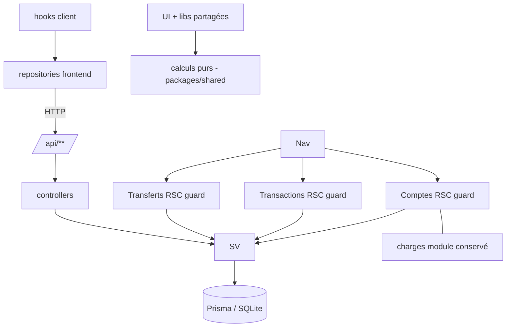

# SPEC-M1-POC — Socle Mbongo : comptes, transactions, transfert 2 phases, snapshots

## 📄 Métadonnées

```yaml
spec_id: "M1-POC-001"
version: "1.4.0"
title: "Socle Mbongo — Comptes, Transactions, Transfert 2 phases, Snapshots de solde"
status: "IN_REVIEW"
author: "Agent IA Expert Architect"
created_at: "2026-11-05"
updated_at: "2026-11-05"
reviewer: "Anco"
related_specs: ["cdc.md §3.1, §3.3, §3.4, §3.5, §10 (M1)"]
project: "mbongo"
priority: "HIGH"
```

```yaml
estimation:
  total_hours: 18
  complexity: "MEDIUM"
  confidence: "HIGH"
  breakdown:
    spec_writing: 2
    schema_definition: 3      # zod shared + prisma
    service_implementation: 5
    controller_implementation: 2
    route_implementation: 1
    ui_pages: 3               # comptes, transactions, transferts
    testing: 2
    documentation: 1
```

**Source de vérité produit :** `cdc.md` (v0.9) — **UI :** `mock_POC.tsx.todo` (maquette mobile-first).

---

## 🎯 Résumé Exécutif

### Description en Une Ligne
> Socle financier de Mbongo : le flux « salaire CHF → compte UBS → transfert Telexoo → BoursoBank → joint » est saisissable de bout en bout, et **tous les soldes sont justes et ancrés sur des snapshots réels**.

### Contexte & Justification
Le M1 du cahier des charges (§10) est la première brique utilisable : sans comptes fiables et sans transfert 2 phases, aucune visualisation, aucune charge, aucune projection n'a de sens. Ce M1 remplace le module d'exemple `charges` du squelette comme brique de référence de l'architecture (R1–R10).

### Objectifs
- [ ] F1 — CRUD de comptes avec toutes les attributions du cdc (devise CHF/EUR, type, propriétaire, découvert, carte à débit différé, statut actif/clos)
- [ ] F2 — Transactions manuelles avec solde par compte fiable à tout moment
- [ ] F5 — Transfert inter-comptes 2 phases (estimé → réalisé, taux effectif + frais déduits, recalcul)
- [ ] F7 (partie M1) — Snapshot manuel du solde à date t, écart calculé, transaction d'ajustement
- [ ] Afficher le solde de chaque compte à partir de son solde d'ouverture et des transactions chargées.
- [ ] Personnes du foyer (lecture seule) — la gestion complète (F8) attend M3
- [ ] Garder les services centrés sur le CRUD filtrable ; réserver les écritures métier aux opérations atomiques nécessaires aux invariants.
- [ ] Définir les contrats HTTP partagés et un repository frontend mince pour les appels navigateur.

### Bénéfices Attendus
| Bénéfice | Impact | Métrique |
|----------|--------|----------|
| Solde réel à 10 secondes (snapshot) | Haut | §3.5 : « actualiser un solde en 10 s » |
| Vérité taux/frais traçable | Haut | taux toujours daté, jamais fondu |
| Brique de référence architecturale | Haut | le module repéré pour tous les suivants |

---

## 👥 Acteurs & Parties Prenantes

| Acteur | Description | Rôle dans cette Feature |
|--------|-------------|-------------------------|
| Utilisateur | Anco (mono-utilisateur) | Seul acteur, saisie à tour de rôle avec l'épouse (F8 = M3) |
| Demandeur | Anco | Valide la spec |

---

## 📌 Périmètre (Scope)

### ✅ In Scope

- [ ] **Schémas Zod** `packages/shared/src/schemas/` : `member.ts`, `account.ts`, `transaction.ts`, `transfer.ts`, `snapshot.ts`
- [ ] **Contrats HTTP typés** partagés : opérations CRUD par ressource et types dérivés des schémas Zod.
- [ ] **Domaine pur** `packages/shared/src/domain/` : calculs réutilisables nécessaires à l’interface, sans orchestration de données ni règles dupliquées dans le backend.
- [ ] **Modèle Prisma** : `Member`, `Account`, `Transaction`, `Transfer`, `BalanceSnapshot` (+ conservation de `Charge`/`ScheduledPayment` en l'état, refonte M2)
- [ ] **Migration compatible** du modèle `Account` existant : conserver les identifiants, soldes et relation `Charge.accountId` ; convertir `balance` en `openingBalance` et `isActive` en statut sans perte d'historique.
- [ ] **Services** CRUD et filtres validés, avec opérations transactionnelles uniquement quand un invariant l’exige.
- [ ] **Controllers + routes API** correspondants
- [ ] **Repository frontend** mince par ressource pour les appels navigateur à `/api` ; aucune logique métier dans les repositories.
- [ ] **UI** mobile-first (patterns de la maquette) : comptes, transactions et transferts en deux phases ; snapshots accessibles depuis le compte concerné.
- [ ] **Seed** façonné sur la maquette (données fictives réalistes, cahier §2.1)
- [ ] **Tests** : domaine pur (unit), services (intégration), endpoints (smoke)

### ❌ Out of Scope

- [ ] Charges typées & échéancier (M2 — F3, F4)
- [ ] Encours carte & échéance de prélèvement automatique (M2 — partie carte différée de F7)
- [ ] Dashboard et consolidation globale CHF/EUR, **Sankey**, provisions et alertes (M3 — F6, F10, F11)
- [ ] Vue foyer complète F8, import CSV F9
- [ ] Auth multi-rôles (mono-utilisateur, une seule session)
- [ ] DDD / Hexagonal / couche commands / store client (interdits, cdc §8.2)
- [ ] Migration pnpm (décision : npm workspaces + turbo conservés, KISS)

### ⚠️ Assumptions

1. Stack : Next.js App Router + Prisma + SQLite + zod + TanStack Query + date-fns, npm workspaces/turbo.
2. R1–R10 du cdc §8.2 s'appliquent tel quel (ce module devient le gabarit).
3. Le module `charges` existant est conservé en l'état (compilable) ; sa refonde complète est la spec M2.
4. Seules devises natives : CHF et EUR. La consolidation globale EUR est hors M1 (F6, M3).
5. Montants de `Transaction` **signés** (négatif = débit) — le solde est une somme directe, KISS ; la UI traduit « sens » (débit/crédit) en signe.
6. Les pages RSC appellent les services directement conformément au CDC R5 ; le repository frontend sert aux appels navigateur.
7. Les services ne calculent pas les soldes de présentation ni les agrégats : les fonctions partagées calculent côté UI quand les données y sont déjà chargées.
8. En M1, un transfert relie deux comptes distincts, CHF vers EUR, conformément au flux Telexoo du CDC.

### 🔄 Modèles existants conservés

| Dépendance | Statut | Note |
|------------|--------|------|
| Prisma + SQLite | ✅ | `DATABASE_URL` via env |
| zod | ✅ | Source unique des types (R7) |
| TanStack Query | ✅ | Cache de lecture hydraté (R8) |
| date-fns | ✅ | Manipulation de dates uniquement |

---

## 🏗️ Architecture & Design

### Diagramme



### Structure des fichiers

```
packages/shared/src/
├── schemas/
│   ├── member.ts          # membre du foyer
│   ├── account.ts         # compte
│   ├── transaction.ts     # transaction
│   ├── transfer.ts        # transfert 2 phases
│   ├── snapshot.ts        # snapshot de solde
│   └── filter.ts          # conservé
├── domain/
    ├── balance.ts         # computeBalance, computeSnapshotGap
    └── conversion.ts      # counterValue, effectiveRate, transferFees
└── contracts/             # contrats HTTP CRUD typés par ressource

apps/web/
├── prisma/schema.prisma   # Member, Account, Transaction, Transfer, BalanceSnapshot (+ Charge/ScheduledPayment conservés)
└── src/
    ├── app/
    │   ├── (dashboard)/
    │   │   ├── comptes/page.tsx
    │   │   ├── transactions/page.tsx
    │   │   └── transferts/page.tsx
    │   └── api/
    │       ├── members/route.ts               # GET (lecture seule, M1)
    │       ├── accounts/route.ts + [id]/route.ts
    │       ├── transactions/route.ts + [id]/route.ts
    │       ├── transfers/route.ts + [id]/route.ts     # PATCH = phase 2
    │       └── snapshots/route.ts                     # GET par compte, POST
    ├── server/
    │   ├── db.ts                              # conservé (server-only)
    │   ├── common/{filter-to-where.ts, http.ts}  # conservés
    │   ├── members/{member.service.ts, members.controller.ts}
    │   ├── accounts/{account.service.ts, accounts.controller.ts}
    │   ├── transactions/{transaction.service.ts, transactions.controller.ts}
    │   ├── transfers/{transfer.service.ts, transfers.controller.ts}
    │   └── snapshots/{snapshot.service.ts, snapshots.controller.ts}
    ├── components/{accounts,transactions,transfers}/ ...
    ├── hooks/ (TanStack Query, aucun fetch direct)
    └── lib/repositories/ (client HTTP typé par ressource)
```

Les pages RSC lisent directement via les services (CDC R5). Les hooks client passent par les repositories frontend, seuls responsables des appels HTTP navigateur. Un repository adapte le transport au contrat partagé ; il ne contient ni calcul ni logique métier.

---

## 🗄️ Modèle de données (Prisma)

```prisma
// ─── Foyer ───
model Member {
  id        String   @id @default(uuid())
  firstName String                      // prénom — info strictement nécessaire (cdc §3.1)
  role      String                      // "PRIMARY" | "PARTNER" — admis à élargir au fil de l'eau
  accounts  Account[]
  createdAt DateTime @default(now())
  updatedAt DateTime @updatedAt
  @@map("members")
}

// ─── Comptes (cdc §2.1, §3.6) ───
model Account {
  id            String   @id @default(uuid())
  name          String                     // "UBS Courant", "BNP Joint"…
  bank          String?                    // saisie libre (UBS, BNP Paribas, BoursoBank…)
  currency      String                     // "CHF" | "EUR" — validations zod à la frontière
  accountType   String                     // "CURRENT" | "CREDIT_CARD" | "JOINT" | "SAVINGS"
  memberId      String?                    // null = compte du couple (joint)
  member        Member?   @relation(fields: [memberId], references: [id])
  overdraftLimit Float    @default(0)       // 0 par défaut — pas de découvert en Suisse
  deferredCard  Boolean  @default(false)   // carte à débit différé (BNP) ou carte de crédit UBS
  billingDay    Int?                       // jour de facturation mensuelle (comptes carte)
  openingBalance Float   @default(0)       // solde initial à la création
  status        String   @default("ACTIVE") // "ACTIVE" | "CLOSED" — jamais de suppression si flux (§3.6)
  closedAt      DateTime?
  transactions  Transaction[]
  snapshots     BalanceSnapshot[]
  charges       Charge[]                  // relation existante conservée pour le module charges
  outgoingTransfers Transfer[] @relation("TransferSourceAccount")
  incomingTransfers Transfer[] @relation("TransferTargetAccount")
  createdAt     DateTime @default(now())
  updatedAt     DateTime @updatedAt

  @@index([memberId]) @@index([status]) @@map("accounts")
}

// ─── Transactions (cdc §3.1 F2) ───
model Transaction {
  id         String    @id @default(uuid())
  accountId  String
  account    Account   @relation(fields: [accountId], references: [id])
  date       DateTime                  // date d'opération
  amount     Float                     // SIGNÉ : négatif = débit, positif = crédit
  category   String?                   // "Logement", "Vie courante"… (exigeable plus tard via zod)
  note       String?
  transferId String?                   // renseigné pour les jambes d'un transfert
  transfer   Transfer? @relation(fields: [transferId], references: [id])
  transferRole String?                 // "SOURCE" | "TARGET" pour distinguer les deux jambes
  createdAt  DateTime  @default(now())
  updatedAt  DateTime  @updatedAt

  @@index([accountId, date]) @@map("transactions")
}

// ─── Transfert 2 phases (cdc §3.3) ───
model Transfer {
  id               String    @id @default(uuid())
  sourceAccountId  String
  sourceAccount    Account   @relation("TransferSourceAccount", fields: [sourceAccountId], references: [id])
  targetAccountId  String
  targetAccount    Account   @relation("TransferTargetAccount", fields: [targetAccountId], references: [id])
  amountSent       Float                 // montant CHF (devise source) envoyé
  rateEstimated    Float                 // taux de référence appliqué dès la phase 1
  rateDate         DateTime              // date du taux de référence — affichage "taux au JJ/MM"
  amountReceived   Float?                // phase 2 : EUR réellement crédité
  rateEffective    Float?                // phase 2 : = amountReceived / amountSent
  fees             Float?                // phase 2 : = montEstimé EUR − reçu (frais + écart, traçables)
  memo             String?
  status           String    @default("ESTIMATED") // "ESTIMATED" | "COMPLETED"
  sentAt           DateTime              // date d'envoi (phase 1)
  receivedAt       DateTime?             // date du crédit réel (phase 2)
  transactions     Transaction[]
  createdAt        DateTime  @default(now())
  updatedAt        DateTime  @updatedAt

  @@index([status])
  @@index([sourceAccountId])
  @@index([targetAccountId])
  @@map("transfers")
}

// ─── Snapshot de solde (cdc §3.5) ───
model BalanceSnapshot {
  id        String    @id @default(uuid())
  accountId String
  account   Account   @relation(fields: [accountId], references: [id])
  date      DateTime              // date de l'observation réelle
  balance   Float                 // solde réel déclaré
  note      String?
  createdAt DateTime  @default(now())
  updatedAt DateTime  @updatedAt

  @@index([accountId, date]) @@map("balance_snapshots")
}
```

**Choix notables :**
- `Transaction.amount` signé → `Solde = openingBalance + Σ(amounts)` ; la UI expose « sens débit/crédit » et traduit en signe à la validation.
- Transfert : `Account` référence les transferts source et cible par deux relations Prisma nommées. Le `Transfer` référence ses jambes via `Transaction.transferId` et `transferRole` (`SOURCE`/`TARGET`) : à la phase 1, le débit source est créé ; le crédit cible naît à la phase 2 avec le montant reçu réel (cdc §3.3).
- **Pas de table `ExchangeRate`** (YAGNI) : le « dernier taux saisi » est dérivé du dernier transfert estimé ou réalisé ; un taux saisi à la main est simplement saisissable dans le formulaire.
- `Charge`/`ScheduledPayment` du squelette conservés en l'état — refonde complète en spec M2.

---

## 🔌 Endpoints REST

| Méthode | Route | Corps (zod) | Réponse | Effet |
|---|---|---|---|---|
| GET | `/api/accounts` | `accountQuerySchema` | `Account[]` | filtres composables `AND`/`OR` et opérateurs `eq`, `not`, `in`, `gte`, `lte`, `contains` ; tri/pagination explicites ; aucun solde calculé dans le service |
| POST | `/api/accounts` | `createAccountSchema` | 201 `Account` | |
| GET | `/api/accounts/:id` | — | 200 / 404 | |
| PATCH | `/api/accounts/:id` | `updateAccountSchema` | 200 | Inclut la **clôture** (`status: "CLOSED"` + `closedAt`) |
| DELETE | `/api/accounts/:id` | — | 204 / 409 si flux existant | Suppression réelle **seulement si compte vierge** (§3.6) |
| GET | `/api/transactions` | `transactionQuerySchema` | `Transaction[]` | filtres composables, tri/pagination explicites |
| POST | `/api/transactions` | `createTransactionSchema` | 201 | `direction` (DÉBIT/CRÉDIT) + `amount` positif → signé |
| PATCH | `/api/transactions/:id` | `updateTransactionSchema` | 200 | |
| DELETE | `/api/transactions/:id` | — | 204 | Bloqué si liée à un transfert |
| GET | `/api/transfers` | `transferQuerySchema` | `Transfer[]` | filtres composables, tri/pagination explicites |
| POST | `/api/transfers` | `createTransferSchema` (phase 1) | 201 | **$transaction** : transfert + débit source |
| PATCH | `/api/transfers/:id` | `completeTransferSchema` (phase 2 : `amountReceived`) | 200 | **$transaction** : taux effectif, frais, crédit cible |
| GET | `/api/snapshots` | `snapshotQuerySchema` (`accountId`) | `BalanceSnapshot[]` | CRUD de lecture ; l'écart courant est calculé côté UI |
| POST | `/api/snapshots` | `createSnapshotSchema` | 201 `BalanceSnapshot` | L'UI calcule l'écart à partir des données chargées et propose une transaction d'ajustement ; rien n'est créé sans validation explicite (§3.5) |
| GET | `/api/members` | — | `Member[]` | lecture seule en M1 |

**Contrats HTTP :** les schémas Zod partagés définissent les entrées/sorties ; les contrats par ressource exposent `findMany`, `findOne`, `create`, `update`, `remove` quand ces opérations s'appliquent. Les opérations spécifiques du transfert restent explicitement typées. Le repository frontend implémente ces contrats via HTTP et ne porte aucune logique métier.

Pour les filtres, les champs simples acceptent une valeur directe en égalité (`?type=...`). Les expressions imbriquées passent dans un paramètre `where` JSON encodé par `URLSearchParams`, avec `AND`/`OR` et les opérateurs de champ `eq`, `not`, `in`, `gte`, `lte`, `contains`. Si les deux formes sont présentes, elles se combinent par `AND`. Le schéma Zod de chaque ressource borne les champs autorisés ; le helper traduit l'expression validée en Prisma.

**Règles de controller (R1) :** zod à l'entrée (`parseBody` / `parseQuery` de `server/common/http.ts`), délégation au service, mapping d'erreurs centralisé (400 validation, 404, 409 invariant, 500). Les `route.ts` sont du wiring pur.

---

## 🧮 Logique métier pure (`packages/shared/src/domain/`)

```typescript
// balance.ts — fonctions pures
computeBalance(account: { openingBalance: number }, transactions: { amount: number }[]): number
computeSnapshotGap(snapshot: { balance: number }, calculated: number): number   // écart = réel − calculé
isOverdraft(account: { overdraftLimit: number }, balance: number): boolean

// conversion.ts — fonctions pures (cdc §3.3 / §3.4)
counterValue(amount: number, rate: number): number                  // contre-valeur au taux
effectiveRate(amountReceived: number, amountSent: number): number
transferFees(amountEstimated: number, amountReceived: number): number // écart estimé − reçu, en devise cible
```

Ces fonctions sont utilisées là où leurs données sont déjà disponibles, principalement dans l'UI. Les services n'exposent pas de `getBalance`, `getNextPayment` ni d'agrégats dédiés lorsqu'un CRUD filtré suffit. Chaque montant converti est affiché avec sa devise d'origine et son taux daté (CDC §6).

**Services : CRUD d'abord ; opérations atomiques uniquement pour préserver un invariant (CDC R4) :**
- `TransferService.create` : vérifie deux comptes actifs distincts (source CHF, cible EUR), puis crée le transfert et la transaction de débit source en un `$transaction`.
- `TransferService.complete` : refuse un transfert déjà complété ; appelle les fonctions pures partagées pour les valeurs persistées (`rateEffective`/`fees`), met à jour le transfert et crée la transaction de crédit cible dans un `$transaction`. Aucun calcul métier n'est réimplémenté dans le service.
- `SnapshotService.create` : crée le snapshot ; l'écart et la proposition d'ajustement sont calculés côté UI, puis une transaction CRUD séparée est créée après validation explicite.
- `AccountService.close` : `status=CLOSED`, `closedAt=aujourd'hui` (les récurrences liées s'arrêteront à cette date, mécanisme M2).
- `AccountService.remove` : refuse si le compte a une transaction, un transfert, un snapshot ou une charge liée (409 « compte non vierge — clôturer plutôt »).

---

## 🎨 UX/UI (patterns maquette)

Mobile-first, navigation adaptée aux trois écrans M1, bottom-sheets de détail, tappable partout — la maquette sert de référence visuelle ; le dashboard complet reste en M3.

| Écran | Contenu M1 | Éléments maquette repris |
|---|---|---|
| **Comptes** | Liste avec solde par compte calculé dans l'UI à partir du solde d'ouverture et de l'historique des transactions ; création, formulaire (nom, banque, devise, type, propriétaire, découvert, carte différée et jour de facturation, solde initial), **clôture**, suppression physique seulement si compte vierge | `AccountFormPage`, `SegmentedToggle` |
| **Transactions** | Liste par compte (filtre compte), saisie date/montant/sens/catégorie/note ; détail via bottom-sheet avec modifier/supprimer | `DetailSheet`, `DetailRow` |
| **Transferts** | Liste : cartes phase 1 « Estimé » (contre-valeur + *taux au …*) / phase 2 « Réalisé » (taux effectif, frais) ; création phase 1 ; bouton « Saisir le crédit » qui ouvre la phase 2 | `TransfertScreen`, cartes 2 phases, badges Estimé/Réalisé |

**Flux de données (R8) :** guards RSC par onglet (`<Suspense>` + `error.tsx`), lectures RSC via les services, hooks TanStack Query (`useAccounts`, `useTransactions(accountId)`, `useTransfers`) via les repositories frontend ; mutations `useMutation` → repository → `/api` + invalidation. Les calculs UI utilisent les fonctions partagées. Le Sankey/donut de la maquette sont **hors périmètre M1** (placeholders « arrive en M3 »).

---

## 🧪 Spécification des Tests

### Unit (domaine pur, > 90 %)

| ID | Description | Entrée | Attendu |
|----|-------------|--------|---------|
| UT-001 | `computeBalance` | ouverture 1000, tx [+500, −200] | 1300 |
| UT-002 | `computeBalance` vide | ouverture 0 | 0 |
| UT-003 | `computeSnapshotGap` | réel 1500, calculé 1420 | +80 |
| UT-004 | `effectiveRate` | reçu 1403.60, envoyé 1500 | 0.93573… (5 déc.) |
| UT-005 | `transferFees` | estimé 1410.73, reçu 1403.60 | 7.13 |
| UT-006 | `counterValue` | 1500 × 1.0634 | 1595.10 |
| UT-007 | validation zod | devise "USD" | rejetée (CHF/EUR exclusivement) |

### Intégration (services, SQLite temporaire)

| ID | Description | Attendu |
|----|-------------|---------|
| IT-001 | Transfert phase 1 complet | 2 lignes : transfert ESTIMATED + tx débit source ; soldes justes |
| IT-002 | Phase 2 | statut COMPLETED, `rateEffective`/`fees` calculés, tx crédit cible créée, contre-valeur cible mise à jour |
| IT-003 | Snapshot avec écart | l'UI calcule `réel − calculé` ; aucune transaction créée sans validation |
| IT-004 | Clôture + suppression | compte vide se supprime (204) ; compte avec flux renvoie 409 |
| IT-005 | Sensitive à l'ordre des dates | `computeBalance` jusqu'à une date t ≡ somme filtrée |

### API (smoke : happy path du cdc, critère de sortie M1)

| ID | Scénario | Attendu |
|----|----------|---------|
| AT-001 | Créer UBS Courant, saisir le salaire +4400 et afficher son solde dans l'UI | solde d'ouverture + 4400 ; aucun agrégat calculé dans le service |
| AT-002 | POST transfer (phase 1) → PATCH reçu (phase 2) | soldes UBS ↓, Bourso ↑ du vrai montant |
| AT-003 | POST snapshot → UI affiche l'écart et propose un ajustement | 201 ; aucune transaction d'ajustement sans confirmation |
| AT-004 | zod invalide | 400, sans écriture |

---

## 📅 Planning & Livrables

| Milestone | Livrable |
|-----------|----------|
| 1 | Schémas zod (`shared/schemas/*`) + domaine pur (`shared/domain/*`) + tests unit |
| 2 | Schéma Prisma complet + migration + seed |
| 3 | Services (CRUD + 4 méthodes transactionnelles) + tests intégration |
| 4 | Controllers + routes API + tests smoke |
| 5 | UI M1 : comptes, transactions et transferts (patterns maquette) |
| 6 | `npm run quality` vert (lint 0, typecheck 0, tests 0 échecs), doc mise à jour (TODO, INDEX) |

**Critère de sortie M1 (cdc §10) :** le flux « salaire → Telexoo → BoursoBank → joint » est saisissable de bout en bout depuis la PWA ; chaque solde de compte affiché est juste et ancrable par snapshot. Les totaux et la consolidation globale relèvent de F6 en M3.

---

## 🚦 Risques & Mitigations

| ID | Risque | Mitigation |
|----|--------|------------|
| R-001 | `Charge` existant bloque le build après réécriture du schéma Prisma | vérifier la compilation du module conservé à l'étape 2 |
| R-002 | Pennes des taux en phase 1 → confusion | la UI impose l'affichage « taux au JJ/MM » sur tout montant estimé |
| R-003 | Montants signés contre-intuitifs | UI « sens + montant positif », validation zod garantit le signe |
| R-004 | Le modèle `Account` existe déjà et est référencé par `Charge` | Migration non destructive : préserver `id`, `Charge.accountId` et le solde courant en l'initialisant dans `openingBalance` ; maintenir `charges` sur `Account` |

---

## ✅ Checklist de Validation

- [x] Périmètre aligné sur le jalon M1 du cdc
- [x] Modèle de données complet conformes au cdc §3.1 (Member, Account, Transaction, Transfer, BalanceSnapshot)
- [x] Décisions §9 respectées (EUR consolidé, soft delete, vocabulaire « charge » laissé à M2, taux datés partout)
- [x] Cas métier §3.3 (2 phases) et §3.5 (snapshot/ajustement) couverts par des tests
- [ ] **Validation par le demandeur → status: VALIDATED avant tout code**

| Version | Date | Auteur | Changement |
|---------|------|--------|------------|
| 1.0.0 | 2026-11-05 | Agent IA Expert Architect | Version initiale |
| 1.1.0 | 2026-11-05 | Agent IA Expert Architect | CRUD filtrable, contrats/repository frontend, calculs côté UI et migration Account non destructive |
| 1.2.0 | 2026-11-05 | Agent IA Expert Architect | Retire la consolidation globale du périmètre M1, conformément aux jalons du CDC |
| 1.3.0 | 2026-11-05 | Agent IA Expert Architect | Garde M1 à trois écrans et précise l’affichage du solde par compte |
| 1.4.0 | 2026-11-05 | Agent IA Expert Architect | Corrige les relations Prisma des transferts et précise le sens CHF vers EUR |
