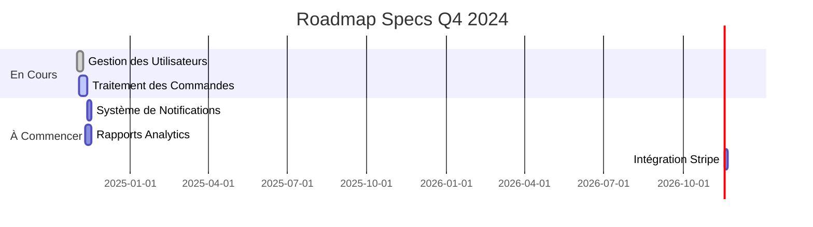

# INDEX.md - Index des Spécifications

> **Index central de toutes les specs validées et en cours.**
> *Mettre à jour cet index à chaque nouvelle spec ou modification.*

---

## 📊 Statistiques

```
Total Specs: <NOMBRE>
├── Validées: <NOMBRE>
├── En Review: <NOMBRE>
├── En Brouillon: <NOMBRE>
└── Obsolètes: <NOMBRE>

Temps moyen par spec: <MOYENNE> heures
Specs en retard: <NOMBRE>
```

---

## 🎯 Specs Validées (✅)

| ID | Titre | Version | Priorité | Statut Dev | Date Validation | Auteur | Reviewer |
|----|-------|---------|----------|------------|-----------------|--------|----------|
| USER-MGT-001 | Gestion des Utilisateurs | 1.0.0 | HIGH | ✅ Complété | 2024-11-05 | Agent IA | John Doe |
| ORDER-PRC-001 | Traitement des Commandes | 1.0.0 | HIGH | 🔄 En cours | 2024-11-04 | Agent IA | Jane Smith |
| AUTH-001 | Authentification JWT | 1.0.0 | HIGH | ✅ Complété | 2024-11-03 | Agent IA | Tech Lead |

### Légende Statut Dev
- ✅ **Complété**: Développement terminé et déployé
- 🔄 **En cours**: Développement en cours
- ⏳ **À commencer**: Spec validée, dev pas encore commencé
- ❌ **Bloqué**: Développement bloqué (voir notes)

---

## 🔍 Specs En Review (🔍)

| ID | Titre | Version | Priorité | Date Soumission | Reviewer Assigné | Date Limite | Statut |
|----|-------|---------|----------|-----------------|------------------|-------------|--------|
| PAYMENT-001 | Intégration Stripe | 1.0.0 | MEDIUM | 2024-11-05 | Finance Team | 2024-11-07 | En attente feedback |

---

## ✏️ Specs en Brouillon (📝)

| ID | Titre | Version | Priorité | Date Création | Auteur | % Complétion | Blocages |
|----|-------|---------|----------|---------------|--------|---------------|----------|
| NOTIF-001 | Système de Notifications | 0.1.0 | LOW | 2024-11-05 | Agent IA | 40% | Attente clarifications |

---

## 🗑️ Specs Obsolètes (🗑️)

| ID | Titre | Version | Remplacée par | Date Obsolescence | Raison |
|----|-------|---------|----------------|-------------------|--------|
| USER-OLD-001 | Ancienne Gestion Utilisateurs | 0.9.0 | USER-MGT-001 | 2024-11-01 | Refactor complète |

---

## 📈 Roadmap des Specs

### Q4 2024



### Prochaines Specs Prioritaires

| Priorité | ID | Titre | Date Cible | Dépendances |
|----------|----|-------|------------|--------------|
| 🔴 HIGH | PAYMENT-001 | Intégration Stripe | 2024-11-08 | AUTH-001 |
| 🔴 HIGH | NOTIF-001 | Système de Notifications | 2024-11-10 | USER-MGT-001 |
| 🟡 MEDIUM | ANALYTICS-001 | Rapports Analytics | 2024-11-15 | ORDER-PRC-001 |
| 🟢 LOW | SEARCH-001 | Moteur de Recherche | 2024-11-20 | Aucun |

---

## 🔍 Recherche Rapide

### Par Domaine

- **Authentification & Sécurité**: AUTH-001
- **Utilisateurs**: USER-MGT-001
- **Commandes**: ORDER-PRC-001
- **Paiements**: PAYMENT-001
- **Notifications**: NOTIF-001

### Par Statut

- **🟢 À développer**: USER-MGT-001, ORDER-PRC-001
- **🟡 En review**: PAYMENT-001
- **🔴 En retard**: (aucun)

### Par Priorité

- **🔴 HIGH**: USER-MGT-001, ORDER-PRC-001, AUTH-001
- **🟡 MEDIUM**: PAYMENT-001, ANALYTICS-001
- **🟢 LOW**: NOTIF-001, SEARCH-001

---

## 📁 Structure des Fichiers

```
docs/
└── specs/
    ├── INDEX.md                     # Ce fichier
    ├── user-management/
    │   ├── SPEC.md                  # Spécification
    │   ├── diagrams/
    │   │   ├── architecture.mmd
    │   │   └── sequence.mmd
    │   ├── examples/
    │   │   └── requests.json
    │   └── decisions.md
    ├── order-processing/
    │   ├── SPEC.md
    │   └── ...
    └── auth/
        ├── SPEC.md
        └── ...
```

---

## 🛠️ Comment Utiliser Cet Index

1. **Trouver une spec**: Utiliser la recherche ou parcourir par domaine
2. **Créer une spec**: 
   - Copier `SPEC_TEMPLATE.md` dans `docs/specs/<nom>/SPEC.md`
   - Remplir tous les champs obligatoires
   - Ajouter une entrée dans cet index
3. **Mettre à jour**: 
   - Mettre à jour le statut quand la spec évolue
   - Garder les statistiques à jour
4. **Archiver**: 
   - Déplacer les specs obsolètes dans la section dédiée
   - Conserver pour référence historique

---

## 📌 Bonnes Pratiques

- **Un index à jour**: Toujours mettre à jour cet index immédiatement après créer/modifier une spec
- **Liens valides**: Vérifier que tous les liens vers les specs fonctionnent
- **Statistiques exactes**: Garder les comptes à jour
- **Priorisation visible**: La roadmap doit refléter les priorités actuelles
- **Archivage propre**: Ne pas supprimer les specs obsolètes, les archiver

---

**Dernière mise à jour:** 2024-11-05  
**Prochaine review:** 2024-11-12  
**Responsable:** Agent IA Expert Architect
