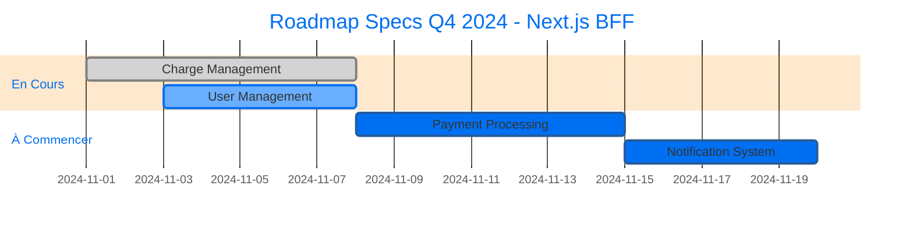

# SPEC_INDEX_TEMPLATE.md - Template d'Index des Spécifications (Next.js BFF)

> **Index central de toutes les specs validées et en cours pour l'architecture Next.js BFF.**

---

## 📊 Statistiques

```
Total Specs: <NOMBRE>
├── Validées: <NOMBRE>
├── En Review: <NOMBRE>
├── En Brouillon: <NOMBRE>
└── Obsolètes: <NOMBRE>

Temps moyen par spec: <MOYENNE> heures
Specs en retard: <NOMBRE>
```

---

## 🎯 Specs Validées (✅)

| ID | Titre | Version | Priorité | Statut Dev | Date Validation | Auteur | Reviewer | Architecture |
|----|-------|---------|----------|------------|-----------------|--------|----------|--------------|
| CHARGE-MGT-001 | Charge Management | 1.0.0 | HIGH | ✅ Complété | 2024-11-05 | Agent IA | John Doe | Next.js BFF |
| USER-001 | User Management | 1.0.0 | HIGH | 🔄 En cours | 2024-11-05 | Agent IA | Jane Smith | Next.js BFF |

### Légende Statut Dev
- ✅ **Complété**: Développement terminé et déployé
- 🔄 **En cours**: Développement en cours
- ⏳ **À commencer**: Spec validée, dev pas encore commencé
- ❌ **Bloqué**: Développement bloqué (voir notes)

---

## 🔍 Specs En Review (🔍)

| ID | Titre | Version | Priorité | Date Soumission | Reviewer Assigné | Date Limite | Statut |
|----|-------|---------|----------|-----------------|------------------|-------------|--------|
| PAYMENT-001 | Payment Processing | 1.0.0 | MEDIUM | 2024-11-05 | Finance Team | 2024-11-07 | En attente feedback |

---

## ✏️ Specs en Brouillon (📝)

| ID | Titre | Version | Priorité | Date Création | Auteur | % Complétion | Blocages |
|----|-------|---------|----------|---------------|--------|---------------|----------|
| NOTIF-001 | Notification System | 0.1.0 | LOW | 2024-11-05 | Agent IA | 40% | Attente clarifications |

---

## 🗑️ Specs Obsolètes (🗑️)

| ID | Titre | Version | Remplacée par | Date Obsolescence | Raison |
|----|-------|---------|----------------|-------------------|--------|
| OLD-CHARGE-001 | Ancienne Gestion Charges | 0.9.0 | CHARGE-MGT-001 | 2024-11-01 | Refactor complète |

---

## 📈 Roadmap des Specs

### Q4 2024



### Prochaines Specs Prioritaires

| Priorité | ID | Titre | Date Cible | Dépendances | Architecture |
|----------|----|-------|------------|--------------|--------------|
| 🔴 HIGH | PAYMENT-001 | Payment Processing | 2024-11-08 | USER-001 | Next.js BFF |
| 🔴 HIGH | NOTIF-001 | Notification System | 2024-11-10 | USER-001 | Next.js BFF |
| 🟡 MEDIUM | INVOICE-001 | Invoice Generation | 2024-11-15 | PAYMENT-001 | Next.js BFF |
| 🟢 LOW | REPORT-001 | Reporting | 2024-11-20 | Aucun | Next.js BFF |

---

## 🔍 Recherche Rapide

### Par Domaine

- **Charges**: CHARGE-MGT-001
- **Utilisateurs**: USER-001
- **Paiements**: PAYMENT-001
- **Notifications**: NOTIF-001

### Par Statut

- **🟢 À développer**: CHARGE-MGT-001, USER-001
- **🟡 En review**: PAYMENT-001
- **🔴 En retard**: (aucun)

### Par Priorité

- **🔴 HIGH**: CHARGE-MGT-001, USER-001, PAYMENT-001
- **🟡 MEDIUM**: NOTIF-001, INVOICE-001
- **🟢 LOW**: REPORT-001

---

## 📁 Structure des Fichiers

```
docs/
└── specs/
    ├── INDEX.md                     # Ce fichier
    ├── charge-management/
    │   ├── SPEC.md                  # Spécification Next.js BFF
    │   ├── schemas/                # Exemples de schémas Zod
    │   │   └── charge.ts           # Schéma Charge
    │   └── diagrams/
    │       └── architecture.mmd    # Diagramme Next.js BFF
    ├── user-management/
    │   ├── SPEC.md
    │   └── ...
    └── payment-processing/
        ├── SPEC.md
        └── ...
```

---

## 🛠️ Comment Utiliser Cet Index

### 1. Trouver une spec
- Utiliser la recherche ou parcourir par domaine
- Filtrer par statut ou priorité

### 2. Créer une spec
```bash
# Copier le template adapté Next.js BFF
cp skills/spec-driven-development/SPEC_TEMPLATE.md docs/specs/<nom>/SPEC.md

# Remplir tous les champs obligatoires
# Ajouter une entrée dans cet index
```

### 3. Mettre à jour
- Mettre à jour le statut quand la spec évolue
- Garder les statistiques à jour
- Archiver les specs obsolètes

### 4. Synchroniser
- Toujours synchroniser avec la todo list Vibe
- Garder les liens valides

---

## 📌 Bonnes Pratiques

- **Un index à jour**: Toujours mettre à jour cet index immédiatement après créer/modifier une spec
- **Liens valides**: Vérifier que tous les liens vers les specs fonctionnent
- **Statistiques exactes**: Garder les comptes à jour
- **Priorisation visible**: La roadmap doit refléter les priorités actuelles
- **Architecture claire**: Toujours indiquer "Next.js BFF" comme architecture
- **Archivage propre**: Ne pas supprimer les specs obsolètes, les archiver

---

## 🎯 Architecture par Défaut

Toutes les specs de ce projet suivent l'**architecture Next.js BFF Fullstack** avec:
- **Packages/shared**: Schémas Zod + Logique métier pure
- **Apps/web/src/server**: Services + Controllers (style NestJS)
- **Apps/web/src/app/api**: Routes API (wiring uniquement)
- **Prisma**: ORM pour la base de données
- **Zod**: Validation des schémas

---

**Architecture:** Next.js BFF Fullstack + NestJS-like Style + KISS  
**Dernière mise à jour:** 2024-11-05  
**Responsable:** Agent IA Expert Architect
