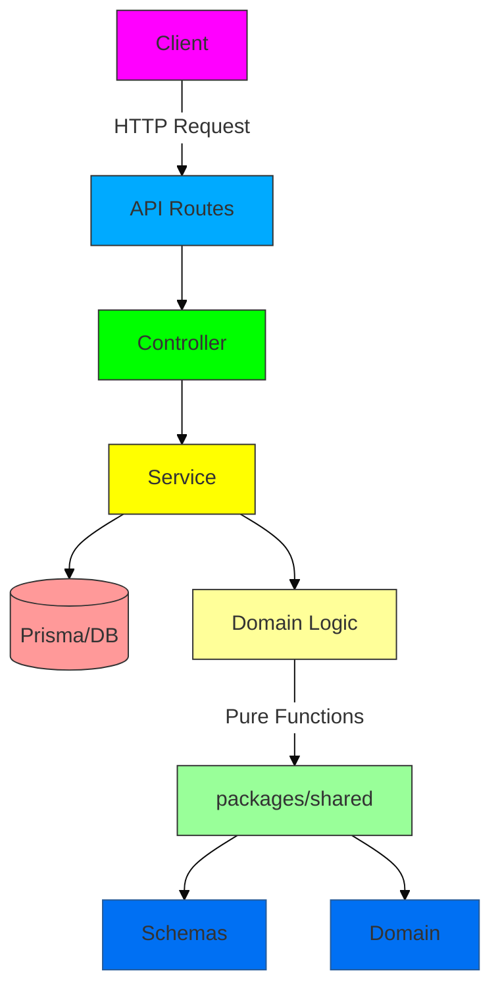

# SPEC_TEMPLATE.md - Template de Spécification Technique (Next.js BFF)

> **⚠️ IMPORTANT:** Ce template DOIT être utilisé pour TOUTE nouvelle fonctionnalité.
> **AUCUN CODE ne peut être écrit sans une spec complétée et validée.**
> **Architecture cible: Next.js BFF Fullstack avec style NestJS**

---

## 📄 Métadonnées

```yaml
# À remplir en premier - Ces champs sont obligatoires
spec_id: "<ID-UNIQUE>"              # Ex: CHARGE-MGT-001, USER-001
version: "1.0.0"                    # Version de la spec (MAJ à chaque changement)
title: "<Titre Court et Descriptif>" # Ex: Charge Management System
status: "DRAFT" | "IN_REVIEW" | "VALIDATED" | "REJECTED" | "DEPRECATED"
  # DRAFT: En cours de rédaction
  # IN_REVIEW: En review avec le demandeur
  # VALIDATED: ✅ Approuvée - LE CODE PEUT COMMENCER
  # REJECTED: Rejetée - À corriger
  # DEPRECATED: Obsolète - Remplacée par une autre spec

# Informations de suivi
author: "<Nom de l'Agent/Rédacteur>"   # Ex: Agent IA Expert
created_at: "<YYYY-MM-DD>"           # Date de création
updated_at: "<YYYY-MM-DD>"           # Date de dernière mise à jour
reviewer: "<Nom du Reviewer>"        # Qui a validé
validated_at: "<YYYY-MM-DD>"        # Date de validation

# Liens et références
related_specs: []                    # IDs des specs liées
jira_ticket: "<JIRA-123>"            # Référence Jira/Ticket (optionnel)
project: "mbongo"                   # Projet associé
priority: "HIGH" | "MEDIUM" | "LOW" # Priorité de la feature
```

```yaml
# Estimation (à remplir avant validation)
estimation:
  total_hours: <nombre>               # Temps total estimé en heures
  complexity: "LOW" | "MEDIUM" | "HIGH" | "VERY_HIGH"
  confidence: "HIGH" | "MEDIUM" | "LOW"  # Confiance dans l'estimation
  
  breakdown:                         # Détail par type de travail
    spec_writing: <heures>            # Rédaction de la spec
    schema_definition: <heures>       # Définition des schémas Zod
    service_implementation: <heures>  # Implémentation des services
    controller_implementation: <heures> # Implémentation des controllers
    route_implementation: <heures>   # Implémentation des routes API
    testing: <heures>                 # Tests
    documentation: <heures>          # Documentation
    review: <heures>                 # Reviews
```

---

## 🎯 Résumé Exécutif

### Description en Une Ligne
> `<Une phrase qui résume la feature>`
> Ex: "Système de gestion des charges avec génération automatique des paiements"

### Contexte & Justification
> **Pourquoi cette feature est nécessaire?**
> - Problème actuel à résoudre
> - Opportunité à saisir
> - Alignement avec la stratégie produit

### Objectifs
- [ ] Objectif 1 (ex: "Permettre aux utilisateurs de créer des charges")
- [ ] Objectif 2 (ex: "Générer automatiquement les paiements planifiés")
- [ ] Objectif 3

### Bénéfices Attendus
| Bénéfice | Impact | Métrique |
|----------|--------|----------|
| Ex: Automatisation des paiements | Haut | -50% temps de traitement |
| Ex: Meilleure UX | Moyen | +20% satisfaction |

---

## 👥 Acteurs & Parties Prenantes

### Acteurs Principaux

| Acteur | Description | Rôle dans cette Feature |
|--------|-------------|-------------------------|
| Utilisateur Final | Personne qui utilise l'application | Bénéficiaire principal |
| Admin | Administrateur du système | Gestion des configurations |

### Parties Prenantes

- **Demandeur:** `<Nom>` - Personne qui a demandé la feature
- **Tech Lead:** `<Nom>` - Responsable technique

---

## 📌 Périmètre (Scope)

### ✅ In Scope (Ce qui est inclus)

- [ ] **Schémas Zod** dans `packages/shared/schemas/`
- [ ] **Service** dans `server/<module>/<module>.service.ts`
- [ ] **Controller** dans `server/<module>/<module>s.controller.ts`
- [ ] **Routes API** dans `app/api/<module>/`
- [ ] **Pages RSC** si nécessaire dans `app/(dashboard)/<module>/`
- [ ] **Tests unitaires** pour la logique métier
- [ ] **Tests d'intégration** pour les services

### ❌ Out of Scope (Ce qui est explicitement exclu)

- [ ] Utilisation de DDD ou Hexagonal Architecture
- [ ] Abstractions inutiles
- [ ] Code "au cas où" (YAGNI)
- [ ] Migration des données existantes (à traiter séparément)

### ⚠️ Assumptions (Hypothèses)

1. **Architecture:** Next.js BFF Fullstack avec style NestJS
2. **ORM:** Prisma utilisé pour la base de données
3. **Validation:** Zod utilisé pour toutes les validations
4. **Langue du code:** Anglais pour tous les noms (variables, fonctions, classes)

### 🔄 Dependencies (Dépendances)

| Dépendance | Type | Statut | Impact si non disponible |
|------------|------|--------|--------------------------|
| Prisma | Package npm | ✅ Installé | Blocage total |
| Zod | Package npm | ✅ Installé | Blocage total |
| Next.js | Framework | ✅ Installé | Blocage total |

---

## 🏗️ Architecture & Design (Next.js BFF)

### Diagramme d'Architecture



### Structure des Fichiers (Next.js BFF)

```
packages/
└── shared/
    └── schemas/
        └── <module>.ts           # Schémas Zod

apps/
└── web/
    ├── prisma/
    │   └── schema.prisma        # Schéma Prisma
    └── src/
        ├── app/
        │   ├── api/
        │   │   └── <module>/
        │   │       ├── route.ts  # GET, POST
        │   │       └── [id]/
        │   │           └── route.ts # GET, PATCH, DELETE
        │   └── (dashboard)/
        │       └── <module>/
        │           └── page.tsx   # Page RSC
        └── server/
            ├── db.ts             # PrismaService Singleton
            ├── common/
            │   ├── filter-to-where.ts
            │   └── http.ts        # Validation Zod
            └── <module>/
                ├── <module>.service.ts
                └── <module>s.controller.ts
```

### Schémas Zod (Source de vérité unique)

```typescript
// packages/shared/schemas/<module>.ts
import { z } from "zod";

// Type enum
const isoDate = z.string().refine((v) => !Number.isNaN(Date.parse(v)), "Invalid date");

export const <Module>TypeSchema = z.enum([
  "VALUE1",
  "VALUE2",
]);

// Main schema
export const <module>Schema = z.object({
  id: z.string().uuid(),
  // ... autres champs
  createdAt: isoDate,
  updatedAt: isoDate,
});

// Derived schemas
export const create<Module>Schema = <module>Schema.omit({ id: true, createdAt: true, updatedAt: true });
export const update<Module>Schema = create<Module>Schema.partial();

// Query schema
export const <module>QuerySchema = z.object({
  // Filtres
  limit: z.number().int().positive().max(500).optional(),
  cursor: z.string().optional(),
});

// Types
export type <Module> = z.infer<typeof <module>Schema>;
export type Create<Module>Input = z.infer<typeof create<Module>Schema>;
export type Update<Module>Input = z.infer<typeof update<Module>Schema>;
export type <Module>Query = z.infer<typeof <module>QuerySchema>;
```

### Base de Données (Prisma Schema)

```prisma
// prisma/schema.prisma
model <Module> {
  id        String   @id @default(uuid())
  // ... champs correspondant aux schémas Zod
  createdAt DateTime @default(now())
  updatedAt DateTime @updatedAt
  
  // Relations si nécessaire
  // user     User    @relation(fields: [userId], references: [id])
}
```

---

## 📋 Fonctionnalités Détailées

### Feature 1: `<Nom de la fonctionnalité>`

#### Description
> Description détaillée de la fonctionnalité.

#### Endpoints API

```
## 🔌 REST API Endpoints

### GET /api/<module>
**Description:** Récupérer la liste des <module>

**Query Parameters:**
```typescript
// Utilise <module>QuerySchema
export const <module>QuerySchema = z.object({
  // ... filtres
  limit: z.number().int().positive().max(500).optional(),
  cursor: z.string().optional(),
});
```

**Response:**
- **200 OK:** Liste des <module>
  ```typescript
  // Array de <Module> (z.infer<typeof <module>Schema>)
  ```

**Validation:**
- Tous les paramètres validés avec Zod dans le controller

### POST /api/<module>
**Description:** Créer un nouveau <module>

**Request Body:**
```typescript
// Utilise create<Module>Schema
```

**Response:**
- **201 Created:** <Module> créé
- **400 Bad Request:** Données invalides

### GET /api/<module>/:id
**Description:** Récupérer un <module> par ID

**Response:**
- **200 OK:** <Module>
- **404 Not Found:** <Module> non trouvé

### PATCH /api/<module>/:id
**Description:** Mettre à jour un <module>

**Request Body:**
```typescript
// Utilise update<Module>Schema (partial)
```

**Response:**
- **200 OK:** <Module> mis à jour
- **404 Not Found:** <Module> non trouvé

### DELETE /api/<module>/:id
**Description:** Supprimer un <module>

**Response:**
- **204 No Content:** Suppression réussie
- **404 Not Found:** <Module> non trouvé
```

#### Implémentation (Service)

```typescript
// server/<module>/<module>.service.ts
import { prisma } from "@/server/db";
import { 
  <Module>Query, 
  Create<Module>Input, 
  Update<Module>Input,
  <Module> 
} from "@mbongo/shared/schemas/<module>";

export class <Module>Service {
  async findMany(query: <Module>Query): Promise<<Module>[]> {
    return prisma.<module>.findMany({
      where: queryToWhere(query), // Utiliser le traducteur
      orderBy: { createdAt: "desc" },
      take: query.limit,
    });
  }

  async findOne(id: string): Promise<<Module> | null> {
    return prisma.<module>.findUnique({ where: { id } });
  }

  async create(input: Create<Module>Input): Promise<<Module>> {
    return prisma.<module>.create({ data: input });
  }

  async update(id: string, input: Update<Module>Input): Promise<<Module>> {
    return prisma.<module>.update({ where: { id }, data: input });
  }

  async remove(id: string): Promise<void> {
    await prisma.<module>.delete({ where: { id } });
  }
  
  // Méthodes métiers spécifiques
  // async doSomethingSpecial(id: string): Promise<Result> {}
}

export const <module>Service = new <Module>Service();
```

#### Implémentation (Controller)

```typescript
// server/<module>/<module>s.controller.ts
import { NextResponse } from "next/server";
import {
  <module>QuerySchema,
  create<Module>Schema,
  update<Module>Schema
} from "@mbongo/shared/schemas/<module>";
import { parseBody, parseQuery, toErrorResponse } from "@/server/common/http";
import { <Module>Service, <module>Service } from "./<module>.service";

export class <Module>sController {
  constructor(private readonly service: <Module>Service) {}

  async find(request: Request): Promise<NextResponse> {
    try {
      const query = parseQuery(request, <module>QuerySchema);
      return NextResponse.json(await this.service.findMany(query));
    } catch (error) {
      return toErrorResponse(error);
    }
  }

  async create(request: Request): Promise<NextResponse> {
    try {
      const input = await parseBody(request, create<Module>Schema);
      return NextResponse.json(await this.service.create(input), { status: 201 });
    } catch (error) {
      return toErrorResponse(error);
    }
  }

  async findOne(id: string): Promise<NextResponse> {
    try {
      const result = await this.service.findOne(id);
      if (!result) {
        return NextResponse.json({ error: "Not found" }, { status: 404 });
      }
      return NextResponse.json(result);
    } catch (error) {
      return toErrorResponse(error);
    }
  }

  async update(request: Request, id: string): Promise<NextResponse> {
    try {
      const input = await parseBody(request, update<Module>Schema);
      const result = await this.service.update(id, input);
      if (!result) {
        return NextResponse.json({ error: "Not found" }, { status: 404 });
      }
      return NextResponse.json(result);
    } catch (error) {
      return toErrorResponse(error);
    }
  }

  async remove(id: string): Promise<NextResponse> {
    try {
      await this.service.remove(id);
      return new NextResponse(null, { status: 204 });
    } catch (error) {
      return toErrorResponse(error);
    }
  }
}

export const <module>sController = new <Module>sController(<module>Service);
```

#### Implémentation (Routes API)

```typescript
// app/api/<module>/route.ts
import { <module>sController } from "@/server/<module>/<module>s.controller";

export const GET = (request: Request) => <module>sController.find(request);
export const POST = (request: Request) => <module>sController.create(request);
```

```typescript
// app/api/<module>/[id]/route.ts
import { <module>sController } from "@/server/<module>/<module>s.controller";

type Context = { params: Promise<{ id: string }> };

export const GET = async (_request: Request, { params }: Context) =>
  <module>sController.findOne((await params).id);

export const PATCH = async (request: Request, { params }: Context) =>
  <module>sController.update(request, (await params).id);

export const DELETE = async (_request: Request, { params }: Context) =>
  <module>sController.remove((await params).id);
```

---

## 🧪 Spécification des Tests

### Stratégie de Test

- **Unit Tests:** Tester la logique métier pure (packages/shared/domain)
- **Integration Tests:** Tester les services avec Prisma
- **API Tests:** Tester les endpoints API

### Cas de Test

#### Unit Tests (Logique Métier)

```markdown
| ID | Description | Input | Expected Output | Priority |
|----|-------------|-------|-----------------|----------|
| UT-001 | Calculer le montant mensuel | Charge avec amount=1200 | 100/month | HIGH |
| UT-002 | Générer les paiements | Charge FIXED_RECURRING | Array de paiements | HIGH |
| UT-003 | Valider un schéma Zod | Input valide | Success | HIGH |
```

#### Integration Tests (Services)

```markdown
| ID | Description | Setup | Action | Expected Result | Priority |
|----|-------------|-------|--------|-----------------|----------|
| IT-001 | Créer un <module> | DB vide | POST /api/<module> | 201 + <Module> en DB | HIGH |
| IT-002 | Récupérer un <module> | 1 <module> en DB | GET /api/<module>/:id | 200 + <Module> | HIGH |
| IT-003 | Filtrer les <module>s | 3 <module>s en DB | GET /api/<module>?filter=... | 200 + Array filtré | MEDIUM |
```

#### API Tests (End-to-End)

```markdown
| ID | Description | Method | URL | Expected Status | Priority |
|----|-------------|--------|-----|-----------------|----------|
| AT-001 | GET liste | GET | /api/<module> | 200 | HIGH |
| AT-002 | POST créer | POST | /api/<module> | 201 | HIGH |
| AT-003 | GET par ID | GET | /api/<module>/123 | 200 | HIGH |
| AT-004 | PATCH update | PATCH | /api/<module>/123 | 200 | HIGH |
| AT-005 | DELETE supprimer | DELETE | /api/<module>/123 | 204 | HIGH |
| AT-006 | POST invalide | POST | /api/<module> | 400 | HIGH |
| AT-007 | GET non trouvé | GET | /api/<module>/999 | 404 | HIGH |
```

### Coverage Attendu

- **Unit Tests:** > 90% (pour packages/shared)
- **Integration Tests:** > 80% (pour les services)
- **API Tests:** > 70% (pour les endpoints critiques)

---

## 📊 Non-Fonctionnel (NFR)

### Performance

| Métrique | Cible | Mesure | Priorité |
|----------|-------|--------|----------|
| Temps de réponse API | < 200ms | p95 | HIGH |
| Throughput | > 1000 req/s | Moyenne | MEDIUM |

### Sécurité

- [ ] Toutes les entrées utilisateur sont validées avec Zod
- [ ] Les erreurs ne révèlent pas d'informations sensibles
- [ ] HTTPS obligatoire en production
- [ ] Rate limiting sur les endpoints publics

### Maintenabilité

- [ ] Code suivant les conventions (CONVENTIONS.md)
- [ ] Documentation complète
- [ ] Tests automatiques
- [ ] Architecture simple et directe

---

## 🎨 UX/UI (si applicable)

### Pages RSC

```typescript
// app/(dashboard)/<module>/page.tsx
import { <Module>Service, <module>Service } from "@/server/<module>/<module>.service";

export default async function <Module>Page() {
  const <module>s = await <module>Service.findMany({});
  
  return (
    <div>
      <h1><Module>s</h1>
      <pre>{JSON.stringify(<module>s, null, 2)}</pre>
    </div>
  );
}
```

### Composants Client

```tsx
// components/<module>/<module>-view.tsx
"use client";
import { use<Module>s } from "@/hooks/use-<module>s";

export function <Module>View() {
  const { data: <module>s, isLoading } = use<Module>s();
  
  if (isLoading) return <div>Loading...</div>;
  
  return (
    <ul>
      {<module>s?.map((<module>) => (
        <li key={<module>.id}>{<module>.label}</li>
      ))}
    </ul>
  );
}
```

---

## 🔄 Migration & Deployment

### Étapes de Migration

1. **Étape 1:** Créer les schémas Zod
2. **Étape 2:** Mettre à jour le schéma Prisma
3. **Étape 3:** Générer le client Prisma (`npx prisma generate`)
4. **Étape 4:** Implémenter les services
5. **Étape 5:** Implémenter les controllers
6. **Étape 6:** Créer les routes API
7. **Étape 7:** Créer les pages RSC (si nécessaire)

### Rollback Plan

1. **Condition:** Si > 5% d'erreurs après déploiement
2. **Action:** Revert vers la version précédente
3. **Temps:** < 5 minutes
4. **Impact:** Aucune perte de données

---

## 📝 Documentation

### Documentation Technique

- [ ] Schémas Zod documentés
- [ ] Diagrammes d'architecture
- [ ] Documentation des endpoints API (Swagger/OpenAPI si nécessaire)

### Documentation Utilisateur

- [ ] Guide d'utilisation (si UI)
- [ ] Exemples d'utilisation de l'API

---

## 📅 Planning & Livrables

### Milestones

| Milestone | Date Cible | Description | Statut |
|-----------|------------|-------------|--------|
| Spec Validée | YYYY-MM-DD | Spec approuvée par le demandeur | ⏳ |
| Schémas Zod | YYYY-MM-DD | Schémas créés et validés | ⏳ |
| Prisma Schema | YYYY-MM-DD | Schéma DB mis à jour | ⏳ |
| Services | YYYY-MM-DD | Services implémentés | ⏳ |
| Controllers | YYYY-MM-DD | Controllers implémentés | ⏳ |
| Routes API | YYYY-MM-DD | Routes API créées | ⏳ |
| Tests | YYYY-MM-DD | Tous les tests passent | ⏳ |
| Release | YYYY-MM-DD | Version finale déployée | ⏳ |

### Livrables

- [ ] Spécification validée (ce document avec status: VALIDATED)
- [ ] Schémas Zod dans packages/shared/schemas/
- [ ] Schéma Prisma mis à jour
- [ ] Services implémentés
- [ ] Controllers implémentés
- [ ] Routes API créées
- [ ] Code source commenté et linté
- [ ] Tests unitaires, d'intégration, API
- [ ] Documentation technique

---

## 🚦 Risques & Mitigations

| ID | Risque | Probabilité | Impact | Mitigation | Statut |
|----|--------|-------------|--------|------------|--------|
| R-001 | Retard dans la validation de la spec | Moyen | Haut | Review early, feedback continu | 🟢 |
| R-002 | Problème avec Prisma | Faible | Haut | Tests de migration avant déploiement | 🟢 |
| R-003 | Changement des requirements | Moyen | Moyen | Itérations courtes, feedback régulier | 🟢 |

---

## ✅ Checklist de Validation

### Avant Validation par le Demandeur

- [ ] Tous les champs de métadonnées sont remplis
- [ ] La description est claire et complète
- [ ] Les schémas Zod sont définis
- [ ] Les endpoints API sont spécifiés
- [ ] Les diagrammes sont précis et à jour
- [ ] Les cas de test sont définis
- [ ] Les NFR sont spécifiés
- [ ] Les dépendances sont identifiées
- [ ] Les risques sont analysés
- [ ] L'estimation est réaliste

### Après Validation

- [ ] ✅ **STATUS CHANGÉ EN VALIDATED**
- [ ] Date de validation remplie
- [ ] Nom du reviewer rempli
- [ ] Version incrémentée si nécessaire
- [ ] Copie archivée dans `docs/specs/`

### Avant de Commencer le Développement

- [ ] Spec est dans `docs/specs/<nom-de-la-feature>/SPEC.md`
- [ ] Todo list générée et synchronisée avec Vibe
- [ ] Branche git créée: `feature/<spec-id>-<nom>`
- [ ] Environnement de développement configuré
- [ ] Tous les membres de l'équipe ont lu et compris la spec

---

## 💬 Feedback & Améliorations

### Feedback sur la Spec

*À remplir par le reviewer:*

> **Commentaires généraux:**
> 

> **Points à clarifier:**
> 1.
> 2.
> 3.

> **Suggestions d'amélioration:**
> 1.
> 2.

### Historique des Changements

| Version | Date | Auteur | Changements | Statut |
|---------|------|--------|-------------|--------|
| 1.0.0 | YYYY-MM-DD | <Auteur> | Version initiale | DRAFT |
| | | | | |

---

## 📌 Annexes

### Glossaire

| Terme | Définition |
|-------|------------|
| BFF | Backend For Frontend - Architecture Next.js Fullstack |
| RSC | React Server Components |
| Zod | Bibliothèque de validation de schémas |
| Prisma | ORM pour les bases de données |

### Références

- [Next.js Documentation](https://nextjs.org/docs)
- [Prisma Documentation](https://www.prisma.io/docs)
- [Zod Documentation](https://zod.dev)

---

## 🎯 Approbation

> **⚠️ ATTENTION:** La spec NE DOIT PAS être marquée comme VALIDATED tant que le demandeur n'a pas explicitement approuvé.

```
┌─────────────────────────────────────────────────────────────┐
│                    APPROBATION OFFICIELLE                    │
├─────────────────────────────────────────────────────────────┤
│                                                             │
│  Je soussigné(e) _______________________________,           │
│  
│  - Ai lu et compris cette spécification dans son intégralité│
│  - Confirme que cette spec répond à mes besoins              │
│  - Autorise le début du développement                        │
│  - Serai disponible pour les questions pendant le dev        │
│  
│  Nom: _______________________________                        │
│  Rôle: ______________________________                        │
│  Date: _______________________________                        │
│  Signature: __________________________                        │
│                                                             │
│  ✅ STATUS: [ ] DRAFT [ ] IN_REVIEW [✅] VALIDATED          │
│                                                             │
└─────────────────────────────────────────────────────────────┘
```

---

**Template Version:** 2.0.0  
**Dernière mise à jour:** 2024-11-05  
**Architecture:** Next.js BFF Fullstack + NestJS-like Style + KISS  
**Auteur:** Agent IA Expert Architect

*Pour toute question sur ce template, contacter l'Agent IA.*
