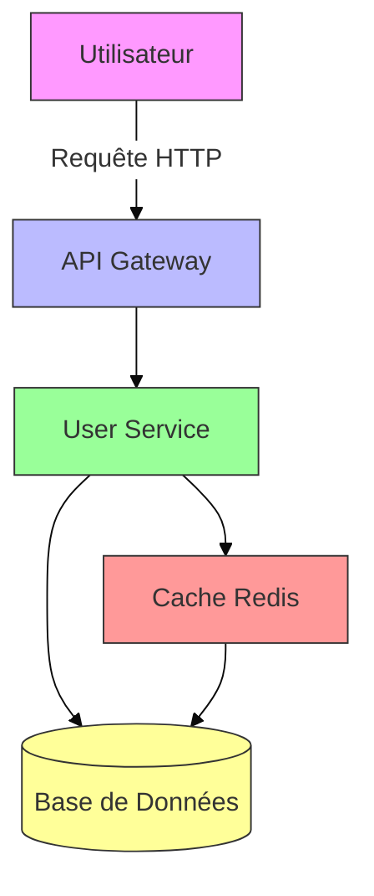
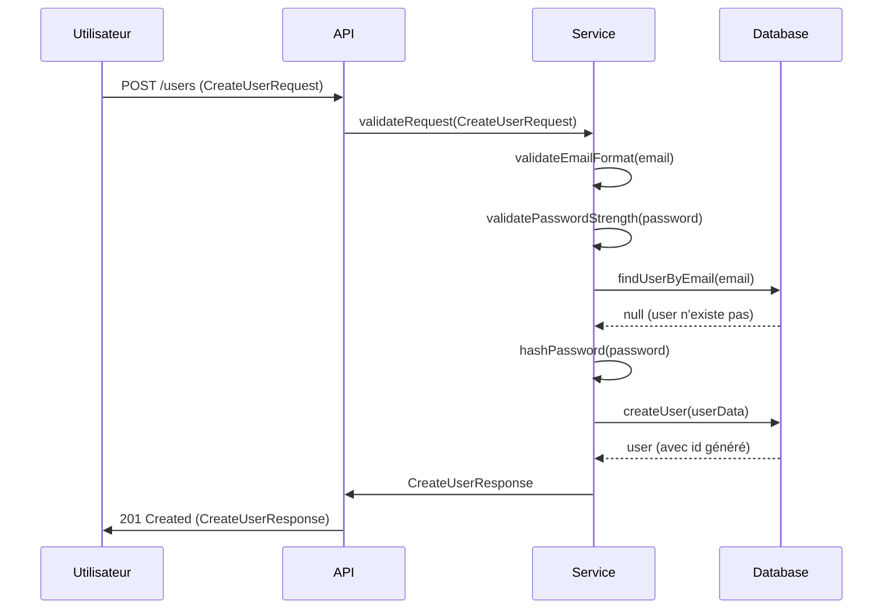

# SPEC_TEMPLATE.md - Template de Spécification Technique

> **⚠️ IMPORTANT:** Ce template DOIT être utilisé pour TOUTE nouvelle fonctionnalité.
> **AUCUN CODE ne peut être écrit sans une spec complétée et validée.**

---

## 📄 Métadonnées

```yaml
# À remplir en premier - Ces champs sont obligatoires
spec_id: "<ID-UNIQUE>"              # Ex: USER-MGT-001
version: "1.0.0"                    # Version de la spec (MAJ à chaque changement)
title: "<Titre Court et Descriptif>" # Ex: Gestion des Utilisateurs
status: "DRAFT" | "IN_REVIEW" | "VALIDATED" | "REJECTED" | "DEPRECATED"
  # DRAFT: En cours de rédaction
  # IN_REVIEW: En review avec le demandeur
  # VALIDATED: ✅ Approuvée - LE CODE PEUT COMMENCER
  # REJECTED: Rejetée - À corriger
  # DEPRECATED: Obsolète - Remplacée par une autre spec

# Informations de suivi
author: "<Nom de l'Agent/Rédacteur>"   # Ex: Agent IA Expert
created_at: "<YYYY-MM-DD>"           # Date de création
updated_at: "<YYYY-MM-DD>"           # Date de dernière mise à jour
reviewer: "<Nom du Reviewer>"        # Qui a validé
validated_at: "<YYYY-MM-DD>"        # Date de validation

# Liens et références
related_specs: []                    # IDs des specs liées
jira_ticket: "<JIRA-123>"            # Référence Jira/Ticket (optionnel)
project: "<Nom du Projet>"          # Projet associé
priority: "HIGH" | "MEDIUM" | "LOW" # Priorité de la feature
```

```yaml
# Estimation (à remplir avant validation)
estimation:
  total_hours: <nombre>               # Temps total estimé en heures
  complexity: "LOW" | "MEDIUM" | "HIGH" | "VERY_HIGH"
  confidence: "HIGH" | "MEDIUM" | "LOW"  # Confiance dans l'estimation
  
  breakdown:                         # Détail par type de travail
    analysis: <heures>               # Analyse technique
    development: <heures>            # Développement
    testing: <heures>                 # Tests
    documentation: <heures>          # Documentation
    review: <heures>                 # Reviews
```

---

## 🎯 Résumé Exécutif

### Description en Une Ligne
> `<Une phrase qui résume la feature>`

### Contexte & Justification
> **Pourquoi cette feature est nécessaire?**
> - Problème actuel à résoudre
> - Opportunité à saisir
> - Alignement avec la stratégie produit

### Objectifs
- [ ] Objectif 1
- [ ] Objectif 2
- [ ] Objectif 3

### Bénéfices Attendus
| Bénéfice | Impact | Métrique |
|----------|--------|----------|
| Ex: Amélioration des performances | Haut | -50% temps de réponse |
| Ex: Meilleure UX | Moyen | +20% satisfaction |

---

## 👥 Acteurs & Parties Prenantes

### Acteurs Principaux

| Acteur | Description | Rôle dans cette Feature |
|--------|-------------|-------------------------|
| Utilisateur Final | Personne qui utilise l'application | Bénéficiaire principal |
| Admin | Administrateur du système | Gestion des configurations |
| API Client | Application tierce | Consommateur de l'API |

### Parties Prenantes

- **Demandeur:** `<Nom>` - Personne qui a demandé la feature
- **Product Owner:** `<Nom>` - Responsable produit
- **Tech Lead:** `<Nom>` - Responsable technique
- **QA:** `<Nom>` - Responsable qualité

---

## 📌 Périmètre (Scope)

### ✅ In Scope (Ce qui est inclus)

- [ ] Fonctionnalité 1
- [ ] Fonctionnalité 2
- [ ] Composant technique 1
- [ ] Intégration avec le système X

### ❌ Out of Scope (Ce qui est explicitement exclu)

- [ ] Fonctionnalité qui ne sera PAS implémentée
- [ ] Intégration avec le système Y (prévue pour la phase 2)
- [ ] Migration des données existantes (traité séparément)

### ⚠️ Assumptions (Hypothèses)

1. **Assumption 1:** Description de l'hypothèse et son impact si fausse
2. **Assumption 2:** Description de l'hypothèse
3. **Assumption 3:** Description de l'hypothèse

### 🔄 Dependencies (Dépendances)

| Dépendance | Type | Statut | Impact si non disponible |
|------------|------|--------|--------------------------|
| Spec API-AUTH-001 | Spec | ✅ Validée | Blocage total |
| Library X v2.0 | Externe | ⚠️ En review | Retard possible |
| Migration DB | Technique | 🔄 En cours | À coordonner |

---

## 🏗️ Architecture & Design

### Diagramme d'Architecture



*Le diagramme ci-dessus est un exemple. **À adapter pour chaque spec.***

### Composants Impactés

```
┌─────────────────────────────────────────────────────────┐
│                    COMPOSANTS IMPACTÉS                    │
├─────────────────────────────────────────────────────────┤
│                                                           │
│  📦 NOUVEAUX COMPOSANTS                                    │
│  ├─ src/core/domain/User.ts              # Entité User   │
│  ├─ src/core/repositories/UserRepository.ts              │
│  └─ src/core/usecases/ManageUser.ts       # Cas d'usage   │
│                                                           │
│  🔄 COMPOSANTS MODIFIÉS                                  │
│  ├─ src/infrastructure/db/connection.ts    # Ajout table    │
│  └─ src/interfaces/api/routes.ts         # Nouvelle route │
│                                                           │
│  ✅ COMPOSANTS NON IMPACTÉS                               │
│  ├─ src/auth/...                         # Pas de changement│
│  └─ src/payment/...                      # Pas de changement│
│                                                           │
└─────────────────────────────────────────────────────────┘
```

### Interfaces & Contrats

#### API Endpoints (si applicable)

```
## 🔌 Endpoints REST

### POST /api/users
**Description:** Créer un nouvel utilisateur

**Request Body:**
```typescript
interface CreateUserRequest {
  email: string;           // Format: email valide
  password: string;        // Min: 8 caractères, Max: 64
  name: string;            // Min: 2 caractères, Max: 100
  role?: UserRole;         // Default: 'user'
}
```

**Response:**
- **201 Created:** Utilisateur créé avec succès
  ```typescript
  interface CreateUserResponse {
    id: string;
    email: string;
    name: string;
    role: UserRole;
    createdAt: string; // ISO 8601
    updatedAt: string; // ISO 8601
  }
  ```
- **400 Bad Request:** Données invalides
- **409 Conflict:** Email déjà utilisé

**Validation:**
- Email: regex `^[\\w.-]+@[\\w.-]+\\.\\w+$`
- Password: min 8 chars, 1 majuscule, 1 chiffre, 1 caractère spécial
- Name: alphanumérique + espaces et tirets

**Rate Limiting:** 10 requêtes/minute par IP
```

#### Events (si architecture event-driven)

```typescript
// Événement émis quand un utilisateur est créé
interface UserCreatedEvent {
  type: 'USER_CREATED';
  payload: {
    userId: string;
    email: string;
    timestamp: string; // ISO 8601
  };
  metadata: {
    correlationId: string;
    version: string;
  };
}
```

### Types & Interfaces

```typescript
// Dans src/shared/types/user.ts

type UserRole = 'admin' | 'user' | 'guest';

interface User {
  id: string;           // UUID v4
  email: string;        // Unique, indexé
  name: string;
  role: UserRole;
  isActive: boolean;    // Default: true
  createdAt: Date;
  updatedAt: Date;
}

interface CreateUserDto {
  email: string;
  password: string;
  name: string;
  role?: UserRole;
}

interface UpdateUserDto {
  name?: string;
  role?: UserRole;
  isActive?: boolean;
}
```

### Base de Données (si applicable)

```sql
-- Table users
CREATE TABLE users (
    id UUID PRIMARY KEY DEFAULT gen_random_uuid(),
    email VARCHAR(255) UNIQUE NOT NULL,
    password_hash VARCHAR(255) NOT NULL,
    name VARCHAR(100) NOT NULL,
    role VARCHAR(20) NOT NULL DEFAULT 'user' CHECK (role IN ('admin', 'user', 'guest')),
    is_active BOOLEAN NOT NULL DEFAULT true,
    created_at TIMESTAMP WITH TIME ZONE NOT NULL DEFAULT NOW(),
    updated_at TIMESTAMP WITH TIME ZONE NOT NULL DEFAULT NOW()
);

-- Index
CREATE INDEX idx_users_email ON users(email);
CREATE INDEX idx_users_role ON users(role);

-- Trigger pour mettre à jour updated_at
CREATE OR REPLACE FUNCTION update_updated_at()
RETURNS TRIGGER AS $$
BEGIN
    NEW.updated_at = NOW();
    RETURN NEW;
END;
$$ LANGUAGE plpgsql;

CREATE TRIGGER trigger_update_users_updated_at
    BEFORE UPDATE ON users
    FOR EACH ROW
    EXECUTE FUNCTION update_updated_at();
```

---

## 📋 Fonctionnalités Détailées

### Feature 1: `<Nom de la fonctionnalité>`

#### Description
> Description détaillée de la fonctionnalité.

#### Règles Métier (Business Rules)

1. **BR-001:** `<Description de la règle>`
   - **Condition:** `<Quand cette règle s'applique>`
   - **Action:** `<Ce qui se passe>`
   - **Exemple:** `<Exemple concret>`

2. **BR-002:** `<Description de la règle>`
   - **Condition:**
   - **Action:**
   - **Exemple:**

#### Flux Principal (Happy Path)



#### Cas d'Erreur & Exceptions

| ID | Scénario | HTTP Status | Message d'Erreur | Code Erreur |
|----|----------|-------------|------------------|-------------|
| ERR-001 | Email déjà utilisé | 409 Conflict | "Email already exists" | DUPLICATE_EMAIL |
| ERR-002 | Email invalide | 400 Bad Request | "Invalid email format" | INVALID_EMAIL |
| ERR-003 | Mot de passe trop faible | 400 Bad Request | "Password too weak" | WEAK_PASSWORD |
| ERR-004 | Erreur base de données | 500 Internal Server Error | "Database error" | DB_ERROR |

#### Algorithmes (si applicable)

**Algorithme 1:** `<Nom de l'algorithme>`

```typescript
// Pseudo-code ou code réel
function calculateUserScore(user: User): number {
  let score = 0;
  
  // Bonus pour l'activité
  if (user.isActive) score += 10;
  
  // Bonus pour le rôle
  const roleScores: Record<UserRole, number> = {
    admin: 30,
    user: 20,
    guest: 5,
  };
  score += roleScores[user.role];
  
  // Bonus pour l'ancienneté (1 point par mois)
  const monthsActive = differenceInMonths(new Date(), user.createdAt);
  score += Math.min(monthsActive, 12); // Max 12 points
  
  return Math.min(score, 100); // Score max: 100
}
```

---

## 🧪 Spécification des Tests

### Stratégie de Test

- **Unit Tests:** Tester chaque fonction en isolation
- **Integration Tests:** Tester l'interaction entre composants
- **E2E Tests:** Tester le flux utilisateur complet
- **Performance Tests:** Vérifier les performances
- **Security Tests:** Vérifier la sécurité

### Cas de Test

#### Unit Tests

```markdown
| ID | Description | Input | Expected Output | Priority |
|----|-------------|-------|-----------------|----------|
| UT-001 | Créer un utilisateur valide | CreateUserDto valide | User avec id généré | HIGH |
| UT-002 | Valider un email valide | "test@example.com" | true | HIGH |
| UT-003 | Valider un email invalide | "invalid-email" | false | HIGH |
| UT-004 | Hash du mot de passe | "password123" | Hash bcrypt valide | HIGH |
| UT-005 | Calculer le score utilisateur | User admin actif | Score entre 40-52 | MEDIUM |
```

#### Integration Tests

```markdown
| ID | Description | Setup | Action | Expected Result | Priority |
|----|-------------|-------|--------|-----------------|----------|
| IT-001 | Créer un utilisateur via API | DB vide | POST /users | 201 + User en DB | HIGH |
| IT-002 | Créer un utilisateur avec email existant | 1 user en DB | POST /users (même email) | 409 Conflict | HIGH |
| IT-003 | Récupérer un utilisateur | 1 user en DB | GET /users/:id | 200 + User | HIGH |
```

#### E2E Tests

```markdown
| ID | Description | Steps | Expected Result | Priority |
|----|-------------|-------|-----------------|----------|
| E2E-001 | Flux d'inscription complet | 1. Aller sur /register 2. Remplir le formulaire 3. Soumettre | Redirection vers /dashboard + email de bienvenue | HIGH |
| E2E-002 | Connexion avec identifiants valides | 1. Aller sur /login 2. Entrer email/password 3. Soumettre | Redirection vers /dashboard | HIGH |
```

#### Performance Tests

```markdown
| ID | Description | Scenario | Target | Priority |
|----|-------------|----------|--------|----------|
| PT-001 | Temps de réponse création utilisateur | 100 requêtes simultanées | < 200ms (p95) | MEDIUM |
| PT-002 | Requêtes par seconde | Charge normale | > 1000 req/s | LOW |
```

#### Security Tests

```markdown
| ID | Description | Test | Expected | Priority |
|----|-------------|------|----------|----------|
| ST-001 | Injection SQL | Essayer ' OR 1=1 -- | Rejeté | HIGH |
| ST-002 | XSS | Essayer <script>alert(1)</script> | Escapé | HIGH |
| ST-003 | Authentification | Accès sans token | 401 Unauthorized | HIGH |
```

### Coverage Attendu

- **Unit Tests:** > 90%
- **Integration Tests:** > 80%
- **E2E Tests:** > 70% (pour les flux critiques)

---

## 📊 Non-Fonctionnel (NFR)

### Performance

| Métrique | Cible | Mesure | Priorité |
|----------|-------|--------|----------|
| Temps de réponse API | < 200ms | p95 | HIGH |
| Throughput | > 1000 req/s | Moyenne | MEDIUM |
| Temps de démarrage | < 2s | Cold start | MEDIUM |

### Sécurité

- [ ] Toutes les entrées utilisateur sont validées et sanitizées
- [ ] Les mots de passe sont hashés avec bcrypt (cost factor: 12)
- [ ] Les tokens JWT ont une expiration de 15 minutes
- [ ] Les endpoints sensibles nécessitent une authentification
- [ ] Les erreurs ne révèlent pas d'informations sensibles
- [ ] HTTPS obligatoire en production

### Scalabilité

- [ ] Architecture stateless (sauf sessions si nécessaire)
- [ ] Base de données optimisée pour les lectures/écritures
- [ ] Cache Redis pour les données fréquemment accédées
- [ ] Horizontal scaling possible

### Fiabilité

- [ ] Disponibilité: 99.9% (en production)
- [ ] MTTR (Mean Time To Recovery): < 30 minutes
- [ ] MTBF (Mean Time Between Failures): > 1 mois

### Maintenabilité

- [ ] Code suivant les conventions (CONVENTIONS.md)
- [ ] Documentation complète
- [ ] Tests automatiques
- [ ] Logging centralisé
- [ ] Monitoring en place

### Accessibilité

- [ ] WCAG 2.1 AA compliant (si interface utilisateur)
- [ ] Compatible avec les lecteurs d'écran
- [ ] Navigation clavier complète

---

## 🎨 UX/UI (si applicable)

### Maquettes / Wireframes

*À ajouter si la feature a une interface utilisateur*

```
[Lien vers Figma/Adobe XD] ou descriptions textuelles
```

### Flux Utilisateur

```mermaid
flowchart TD
    A[Page d'accueil] -->|Click "S'inscrire"| B[Formulaire d'inscription]
    B -->|Soumettre| C{Validation}
    C -->|Valide| D[Tableau de bord]
    C -->|Invalide| B
    D -->|Logout| A
```

### Copywriting (Textes)

| Élément | Texte | Notes |
|---------|-------|-------|
| Bouton Inscription | "Créer un compte" | CTA principal |
| Message de succès | "Bienvenue ! Votre compte a été créé." | Après inscription |
| Erreur email | "Cet email est déjà utilisé." | Message clair |

---

## 🔄 Migration & Deployment

### Étapes de Migration

1. **Étape 1:** Créer les nouvelles tables en DB
2. **Étape 2:** Déployer les nouveaux services
3. **Étape 3:** Mettre à jour les interfaces
4. **Étape 4:** Nettoyer les anciens composants (si remplacement)

### Rollback Plan

1. **Condition:** Si > 5% d'erreurs après déploiement
2. **Action:** Revert vers la version précédente
3. **Temps:** < 5 minutes
4. **Impact:** Aucune perte de données

### Feature Flags

| Flag | Description | Default | Rollout Strategy |
|------|-------------|---------|------------------|
| new_user_management | Active la nouvelle gestion des utilisateurs | false | Gradual rollout (10% → 100%) |

---

## 📝 Documentation

### Documentation Technique

- [ ] Architecture Decision Records (ADR) pour les décisions majeures
- [ ] Diagrammes à jour (architecture, séquence, classes)
- [ ] Documentation des APIs (Swagger/OpenAPI)
- [ ] README des nouveaux modules

### Documentation Utilisateur

- [ ] Guide utilisateur
- [ ] FAQ
- [ ] Exemples d'utilisation
- [ ] Tutorials vidéo (si nécessaire)

---

## 📅 Planning & Livrables

### Milestones

| Milestone | Date Cible | Description | Statut |
|-----------|------------|-------------|--------|
| Spec Validée | YYYY-MM-DD | Spec approuvée par le demandeur | ⏳ |
| Dev Commencé | YYYY-MM-DD | Premier commit de code | ⏳ |
| Alpha | YYYY-MM-DD | Version interne testable | ⏳ |
| Beta | YYYY-MM-DD | Version beta pour feedback | ⏳ |
| Release | YYYY-MM-DD | Version finale déployée | ⏳ |

### Livrables

- [ ] Spécification validée (ce document avec status: VALIDATED)
- [ ] Code source commenté et linté
- [ ] Tests unitaires, d'intégration, E2E
- [ ] Documentation technique
- [ ] Documentation utilisateur (si applicable)
- [ ] Scripts de migration (si applicable)
- [ ] Configuration de deployment

---

## 🚦 Risques & Mitigations

| ID | Risque | Probabilité | Impact | Mitigation | Statut |
|----|--------|-------------|--------|------------|--------|
| R-001 | Retard dans la validation de la spec | Moyen | Haut | Review early, feedback continu | 🟢 |
| R-002 | Problème de performance en prod | Faible | Haut | Tests de charge avant déploiement | 🟢 |
| R-003 | Changement des requirements | Moyen | Moyen | Itérations courtes, feedback régulier | 🟢 |
| R-004 | Dépendance externe bloquante | Faible | Haut | Solution de fallback, monitoring | 🟡 |

---

## ✅ Checklist de Validation

### Avant Validation par le Demandeur

- [ ] Tous les champs de métadonnées sont remplis
- [ ] La description est claire et complète
- [ ] Les diagrammes sont précis et à jour
- [ ] Les interfaces/contrats sont définis
- [ ] Les règles métier sont explicites
- [ ] Les cas d'erreur sont couverts
- [ ] Les tests sont spécifiés
- [ ] Les NFR sont définis
- [ ] Les dépendances sont identifiées
- [ ] Les risques sont analysés
- [ ] L'estimation est réaliste

### Après Validation

- [ ] ✅ **STATUS CHANGÉ EN VALIDATED**
- [ ] Date de validation remplie
- [ ] Nom du reviewer rempli
- [ ] Version incrémentée si nécessaire
- [ ] Copie archivée dans `docs/specs/`

### Avant de Commencer le Développement

- [ ] Spec est dans `docs/specs/<nom-de-la-feature>/SPEC.md`
- [ ] Todo list générée et synchronisée avec Vibe
- [ ] Branche git créée: `feature/<spec-id>-<nom>`
- [ ] Environnement de développement configuré
- [ ] Tous les membres de l'équipe ont lu et compris la spec

---

## 💬 Feedback & Améliorations

### Feedback sur la Spec

*À remplir par le reviewer:*

> **Commentaires généraux:**
> 

> **Points à clarifier:**
> 1.
> 2.
> 3.

> **Suggestions d'amélioration:**
> 1.
> 2.

### Historique des Changements

| Version | Date | Auteur | Changements | Statut |
|---------|------|--------|-------------|--------|
| 1.0.0 | YYYY-MM-DD | <Auteur> | Version initiale | DRAFT |
| | | | | |

---

## 📌 Annexes

### Glossaire

| Terme | Définition |
|-------|------------|
| UserRole | Rôle d'un utilisateur dans le système |
| UUID | Universally Unique Identifier |

### Références

- [Lien vers la documentation existante]
- [Lien vers les specs liées]
- [Lien vers les tickets Jira]

---

## 🎯 Approbation

> **⚠️ ATTENTION:** La spec NE DOIT PAS être marquée comme VALIDATED tant que le demandeur n'a pas explicitement approuvé.

```
┌─────────────────────────────────────────────────────────────┐
│                    APPROBATION OFFICIELLE                    │
├─────────────────────────────────────────────────────────────┤
│                                                             │
│  Je soussigné(e) _______________________________,           │
│  
│  - Ai lu et compris cette spécification dans son intégralité│
│  - Confirme que cette spec répond à mes besoins              │
│  - Autorise le début du développement                        │
│  - Serai disponible pour les questions pendant le dev        │
│  
│  Nom: _______________________________                        │
│  Rôle: ______________________________                        │
│  Date: _______________________________                        │
│  Signature: __________________________                        │
│                                                             │
│  ✅ STATUS: [ ] DRAFT [ ] IN_REVIEW [✅] VALIDATED          │
│                                                             │
└─────────────────────────────────────────────────────────────┘
```

---

**Template Version:** 1.0.0  
**Dernière mise à jour:** 2024-11-05  
**Auteur:** Agent IA Expert Architect  

*Pour toute question sur ce template, contacter l'Agent IA.*
